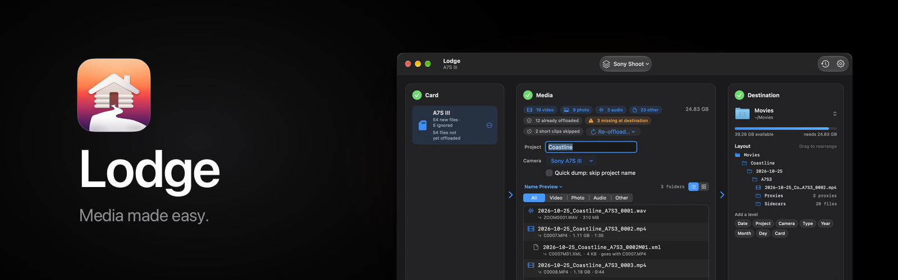
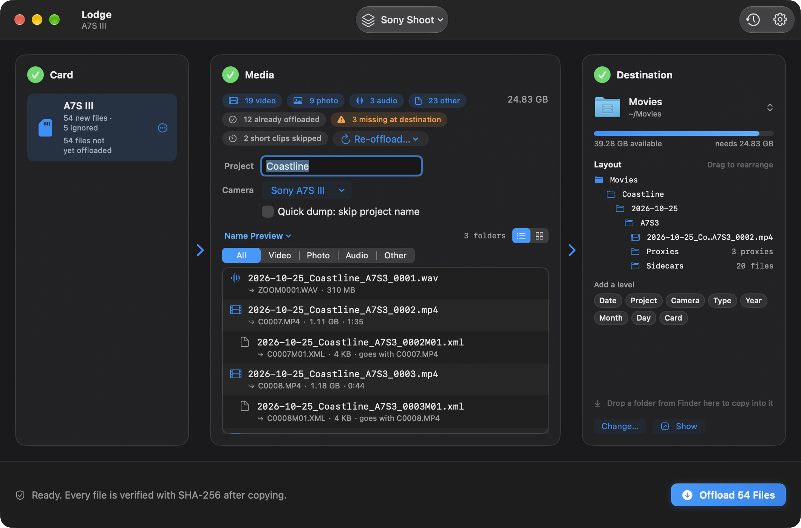
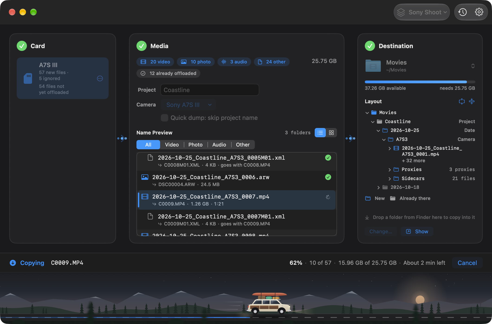
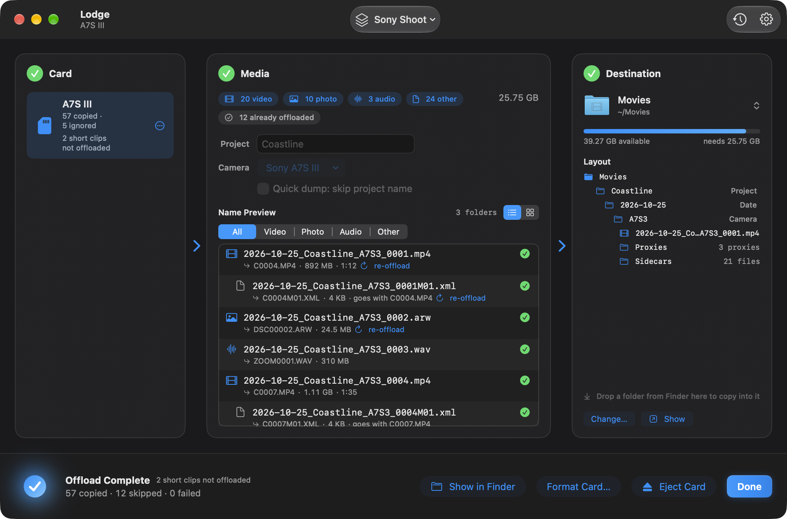

  <picture>
    <source media="(prefers-color-scheme: light)" srcset="docs/assets/lodge-header-light.png">
    <source media="(prefers-color-scheme: dark)" srcset="docs/assets/lodge-header-dark.png">
    
  </picture>

<h1 align="center">From card to calm.</h1>

  Lodge gets your footage off camera cards safely, checked and neatly named.

  Lodge is a universal app. It runs on Apple silicon and Intel Macs, on macOS 14 or later.

  
  
  
  

  

  This picture is the next update. Lodge 1.0.0 keeps the preset menu in the center of the toolbar, and the title reads Lodge.

## Key features

Lodge 1.0.0 is the download below. **Coming in the next update** marks anything newer than that download. Where 1.0.0 works differently, the note says how.

- **Verified copies.** Each file is written as `<name>.lodge-partial`, read back, and hashed. When the SHA-256 matches the card, Lodge renames it to the final name. A mismatch deletes the partial file and reports a failure. The card is only read.
- **Names from a template.** The default is `{date}/{project}` and `{date}_{project}_{seq}`. In Settings > Naming the menu is **Examples**: ready-made folder and file pairs, plus token buttons and a live example. `{project}` is the shoot or job name.
- **A ledger of what was copied.** Lodge remembers each verified file in `~/Library/Application Support/Lodge/ledger.json`. The same card again copies only what is new. If a copy is missing or its size has changed, Media warns you, in orange, and offers **Re-offload**.
- **Ready to format.** When every file has a verified copy that is still at the destination, the card shows a green **Ready to format** badge, and **Format Card…** is available. Cancel is the default. Lodge keeps exFAT, FAT32, or FAT16, and the card’s name.
- **Short clips.** **Skip videos shorter than** runs from **Off** to **30 s**. The default is **5 s**. A stepper beside the slider goes up to 60 seconds. Skipped clips stay on the card with their sidecars until you choose **Include Anyway** or **Include All**.
- **Presets for each camera.** A preset saves the setup: where the footage goes, how the folders and files are named, which camera, short clips, quick dump, and the file rules for proxies, sidecars, and ignored names. You choose it from the preset menu. Lodge remembers the camera you used with each card, by the card’s volume UUID or its name, and selects that camera again when the card is inserted. After you change the setup, the menu says **Edited** and offers to update that preset. Manage them in Settings > Presets. **Coming in the next update.** The preset menu sits at the top right of the window, just left of **Recent Offloads** and **Settings**, and the window title is hidden. In Lodge 1.0.0 the preset menu is in the center of the toolbar, and the title reads Lodge.
- **Quick dump.** **Quick dump: skip project name** takes `{project}` out of the templates, so there is nothing to type. Numbering carries on from the files already in the folder. **Coming in the next update.** The checkbox reads **Quick dump**, with an ⓘ beside it. Hover or click the ⓘ and it says: Skips the project name and dumps all the footage straight into a dated folder.
- **Proxies and sidecars.** A `.lrv` file is a low-resolution proxy. Lodge does not copy it as video. With the default file rules, `lrv` and `lrf` go in a **Proxies** folder, and `thm`, `xml`, and `srt` go in a **Sidecars** folder. Both keep the clip’s new name. Lodge never copies the ignore list, or system junk such as `recycler` and `recycled`.
- **A folder for each extension.** **Coming in the next update.** Inside the folder the template makes, each file goes in a folder named for its extension, in capitals: `MP4/`, `ARW/`, `WAV/`, and the rest. `.mp4` and `.MP4` share `MP4/`. `.JPG`, `.JPEG`, and `.JPE` share `JPG/`. `.TIF` and `.TIFF` share `TIF/`. An extension Lodge does not know still gets a folder (`.xyz` goes in `XYZ/`). A file with no extension stays in the template folder. Proxies stay in **Proxies/** and sidecars stay in **Sidecars/**, not in `LRV/` or `XML/`. Audio recorded with a clip, such as `C0001.WAV`, goes in `WAV/` and keeps that clip’s name and number. A JPEG beside a RAW file is its own photo, in `JPG/`, with the next number. One sequence runs across the whole shoot folder, including every format folder, and continues after files already there. If the template uses `{type}`, the extension folder sits inside `Video/`, `Photo/`, `Audio/`, or `Other/`. In Lodge 1.0.0 the files land in the folder the template makes. Proxies and sidecars already have their own folders, and audio recorded with a clip stays next to that clip.
- **Updates.** **Coming in the next update.** **Lodge > Check for Updates…** looks for a new version. The item is dimmed while a check is already running. In Settings > General, under **Updates**, **Automatically check for updates** is on, and **Automatically download and install updates** is off. The second switch is unavailable while automatic checks are off. Lodge checks once a day. Lodge 1.0.0 does not check. Download the next version from Gumroad. That version is the first one that can look for a newer one.
- **Favorites.** On launch, Lodge selects the default favorite when that drive is connected, then the last-used favorite if that drive is connected, then any other connected favorite.
- **Themes.** Lodge opens in Dark mode with the **Default** theme: a neutral black window and system-blue controls. **Aurora**, **Ocean**, **Twilight**, **Ember**, and **Forest** are optional colour themes in Settings > Appearance.
- **Motion.** A finished offload draws its checkmark and counts the copied files up. Inserting a card glows the card panel. Rows and thumbnail tiles lift under the pointer. The **Ready to format** badge glows when it appears. Turn on Reduce Motion in System Settings and Lodge keeps still.

### Layout

Once a card is scanned, **Layout** in Destination shows the folders the offload will make, including **Proxies** and **Sidecars** when those files are in the plan. Drop a Finder folder on Destination, or on the tree, to copy there.

In Lodge 1.0.0 you drag a level to rearrange it, or drag a token from **Add a level** onto the tree. Click a token to add it at the end. The header says **Drag to rearrange**. Hover a level to remove it. The tree shows one example file name, and extra folders appear as a line such as **+ 2 more folders**. A level that quick dump removes is struck through and tagged **Quick dump**.

**Coming in the next update.** **Expand All** and **Collapse All** open or close the tree. Option-click a triangle does the same for everything inside that folder. Drop a level or a token on the left or right side of a folder’s name to put the tokens side by side, such as `{project}_{date}`. The separator is **Underscore**, **Hyphen**, **Space**, or **None**. When a folder holds more than one file, they start as one line: the first name, with **+ N more** under it. The tree also lists a folder for each extension, such as `MP4/`, `ARW/`, and `WAV/`, with **Proxies** and **Sidecars** after those. Lodge 1.0.0 puts the files in the folder the template makes, and only proxies and sidecars get a folder of their own.

The card’s line reads **54 new files · 5 ignored** before and during an offload, and **57 copied · 5 ignored** when that offload has finished. Ignored items are system files and anything on your ignore list. They are counted, and they are not copied.

| Ready | Copying | Finished |
| --- | --- | --- |
|  |  |  |

These pictures are the next update’s window. The preset menu is at the top right, the title is hidden, and the copying and finished pictures include the wagon on the offload bar. They still put files in the template’s folders, with **Proxies** and **Sidecars**, rather than a folder per extension. Lodge 1.0.0 keeps the preset menu in the center of the toolbar, the title reads Lodge, and the offload bar has no wagon.

## Download Lodge

  

[Download Lodge from Gumroad](https://bashframes.gumroad.com/l/lodge). Open the disk image and drag Lodge to Applications.

Lodge is not notarized. The first time you open it:

- **macOS 15 Sequoia and later.** Open Lodge, click **Done** on the warning, then go to **System Settings > Privacy & Security**, click **Open Anyway** next to Lodge, and confirm.
- **macOS 14 Sonoma.** Right-click or Control-click Lodge, choose **Open**, then **Open** again.

The first time Lodge reads a card, macOS asks for access to files on a removable volume. Choose **Allow**.

## Getting started

1. Move Lodge to Applications and open it, using the steps above if macOS stops you.
2. Click **Choose Folder…** in Destination, or drop a folder from Finder. Lodge remembers that folder. To keep it in the list you switch from, open the folder’s menu and choose **Add “Folder” to Favorites**.
3. Insert a memory card, or a card reader. Lodge notices removable drives mounted under `/Volumes`, including a card that was already in when it opened, and brings its window forward.
4. Name the shoot if your template asks for a project, then click **Offload**.

The next time Lodge opens, it selects the default favorite when that drive is connected, then the last-used favorite if that drive is connected, then any other connected favorite. Closing the window quits Lodge.

The longer path, including what to do if Offload is waiting, is in [Getting started](docs/getting-started.md).

## Documentation

- [Getting started](docs/getting-started.md)
- [User guide](docs/user-guide.md)
- [FAQ](docs/faq.md)
- [Changelog](docs/changelog.md)
- [Website](https://bashcrandicoot.github.io/Lodge/)
- [Contributing](CONTRIBUTING.md)
- [Security](SECURITY.md)

## Support

Lodge is made by BashFrames. For help, write to [bashframes@gmail.com](mailto:bashframes@gmail.com).

**Coming in the next update.** **Help > Contact Support…** opens an email to that address, with the subject Lodge Support and the Lodge and macOS versions under your message. **Lodge > Support Lodge…** and **Help > Support Lodge…** open the same page as the link below. **Lodge > About Lodge** says Made by BashFrames, with a link to the same email. Settings > General ends with Made by BashFrames, a **Support** link, and **Support Lodge ♥**.

After five offloads where every file was copied and verified, and at least three days after you first open that version, a small card asks if you want to support Lodge. It appears only when Lodge is idle, never during a copy, and at most twice. **Maybe Later** asks once more, 30 days later. **Support Lodge** and **Don’t Ask Again** stop it.

If Lodge has been useful, [Support Lodge](https://bashframes.gumroad.com/l/lodge). Pay what you want.

## License

MIT. See [LICENSE](LICENSE). © 2026 BashFrames.
