# Lodge

A small native macOS app (SwiftUI) that offloads camera SD cards — video, photos, audio
and sidecar files — safely, verified, and named the way you want.
Formerly SnapDrop: on its first launch Lodge copies the old app’s data and settings (it never moves or changes them).

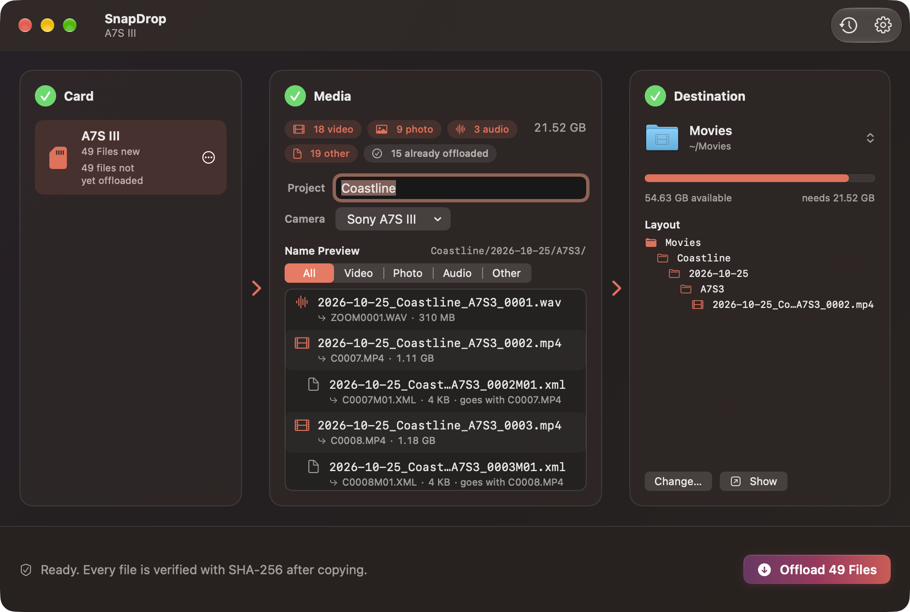

## What it does

1. **Notices when you insert a card.** Any removable drive mounted under `/Volumes`
   that has media on it (cards already inserted at launch count too).
2. **Finds everything worth keeping** anywhere on the card: video, photos, audio and
   other files such as Sony's `C0001M01.XML` metadata (see [File types](#file-types)).
   System junk is never copied.
3. **Names files from a template** you set in Settings → Naming, e.g.
   `{project}/{date}/{camera}` + `{date}_{project}_{camera}_{seq}`. You fill in the
   project (the shoot or job name, e.g. "Beach Shoot") and camera in the main window; a
   live preview shows exactly what every file will be called before anything is copied,
   and the copy uses exactly those names.
4. **Copies only new files**, with the default layout:

   ```
   Destination/
     2026-10-25/
       BeachShoot/
         2026-10-25_BeachShoot_0001.mp4
         2026-10-25_BeachShoot_0001M01.xml    ← sidecar keeps its clip's name
         2026-10-25_BeachShoot_0002.arw
   ```

   - The date is the file's creation date (or modification date if there's none).
   - Numbers continue after the highest one already in that folder, so a second card
     from the same shoot picks up where the first left off. Nothing is ever overwritten.
   - Extensions are lowercased.
5. **Verifies every copy** with SHA-256. Each file is first copied to
   `<name>.lodge-partial`, the copy is re-read from disk and hashed, and only when it
   matches the source is it renamed to its final name. A mismatch deletes the partial
   file and is reported as a failure.
6. **Remembers what it copied** in a ledger at
   `~/Library/Application Support/Lodge/ledger.json`, so inserting the same card
   again only copies files that are new. A file is identified by the card's volume UUID
   (or name) + its path on the card + size + modification time.

Lodge **never changes or deletes anything on the card** — unless you explicitly ask it
to [format a card](#formatting-a-card) whose files have all been copied and verified.

## The window

The main window reads left to right, like a funnel:

**① Card → ② Media → ③ Destination**, with the offload bar along the bottom.

- **Card** — the inserted cards. Pick one if more than one is mounted. A card whose files
  are all safely offloaded gets a green **Ready to format** badge; the **…** button (or a
  right-click) has **Format Card…** and **Eject Card**.
- **Media** — chips like *18 video · 9 photo · 3 audio · 19 other* and how many files
  were already offloaded; the **Project** and **Camera** fields (only the ones your
  template uses are required); and the live name preview, with an
  *All / Video / Photo / Audio / Other* filter. Sidecars are shown indented under their clip.
  A card with no media on it says *Card Is Empty*.
- **Destination** — the folder and its free space. Click the folder to switch between
  your [favorite destinations](#favorite-destinations). Once a card is scanned it also
  shows how much space the offload needs and the folder layout files will land in.
  The **Layout** tree shows every folder the offload makes, per-type, *Proxies* and
  *Sidecars* folders included. Click a triangle to open a folder (Option-click opens or
  closes everything inside it), or use **Expand All** / **Collapse All** next to the title.
  Folders that are already there have a filled icon; ones still to be made are outlined;
  other folders already at the destination are listed dimmed. A folder's files are folded
  into one line ("C0001.MP4 + 11 more") that opens to list them. Long trees scroll.
  To change the folder template here: drag a level, or a token from **Add a level**,
  *between* two folders to make a new level, or onto the *left or right side* of a
  folder's name to put it side by side in that level — e.g. `{project}_{date}`. Drag a
  piece of a combined name between folders to give it its own level again, or along the
  name to reorder it. Hover a combined level for its separator menu (`_`, `-`, space or
  none); right-click a piece to remove it. Combined levels are plain template text, so
  every saved template and preset keeps working.
- **Offload bar** — the big **Offload N Files** button. When it's disabled it tells you
  why ("Enter a project name", "Choose a camera", "Not enough space…"). While copying it
  shows the current file, *X of N*, bytes copied, time left and a *Verifying* state, plus
  **Cancel**; the preview highlights the file being copied and ticks off each verified
  one. When it's done: **Show in Finder**, **Format Card…** (when the card is ready to
  format), **Eject Card** and **Done**, and a "Glass" sound plays if everything copied
  and verified.

When you insert a card Lodge fills in the funnel and brings its window to the front —
no pop-up sheet. The clock button in the toolbar shows **Recent Offloads**.
Animations follow System Settings → Accessibility → Display → **Reduce motion**.

Lodge opens in Dark Mode with the **Default** theme: a neutral near-black window with no
colour wash, and the standard macOS accent colour — system blue — on the **Offload** button,
switches, sliders, selected segments, selection, progress and badges (it follows your accent
colour in System Settings ▸ Appearance). The ready-to-format badge and verified ticks stay
green, warnings orange and destructive actions red. Colour themes
and Light Mode are one click away in [Settings → Appearance](#themes-and-appearance).

| Ready | Copying | Finished |
| --- | --- | --- |
|  | 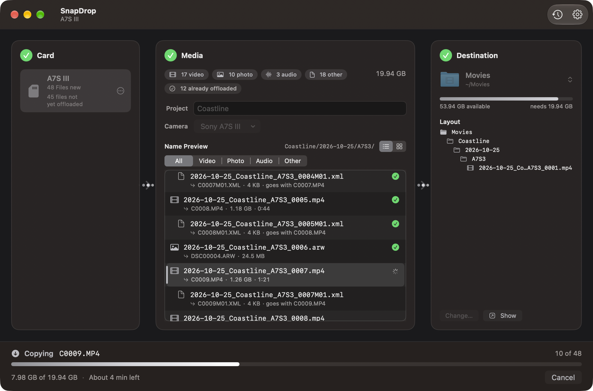 | 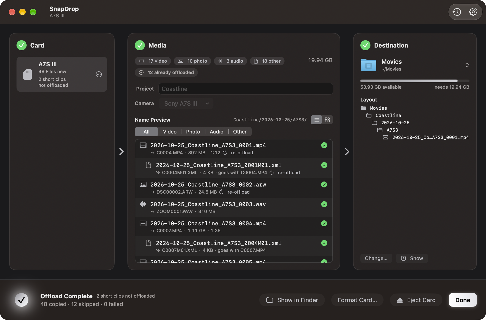 |

| No card | Light Mode | Ember theme |
| --- | --- | --- |
| 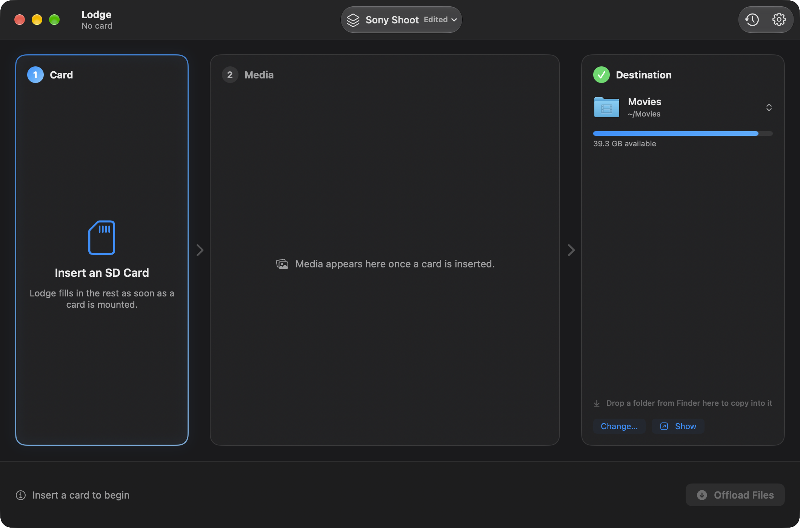 | 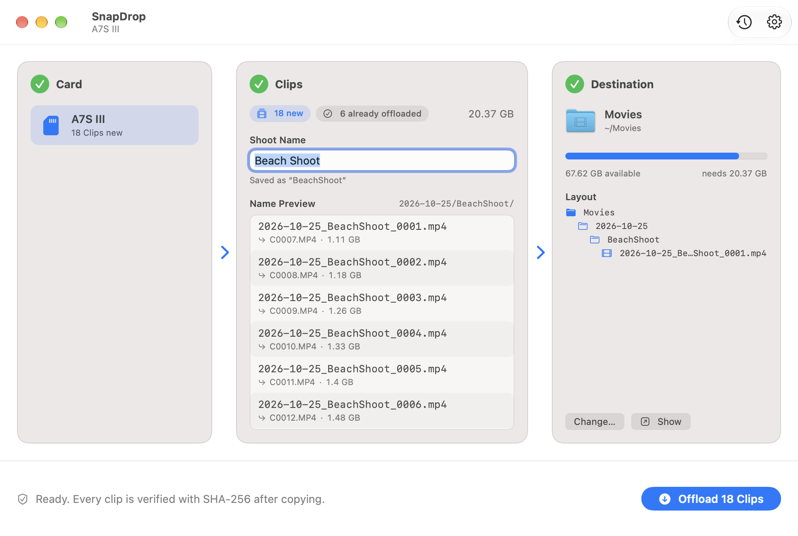 | 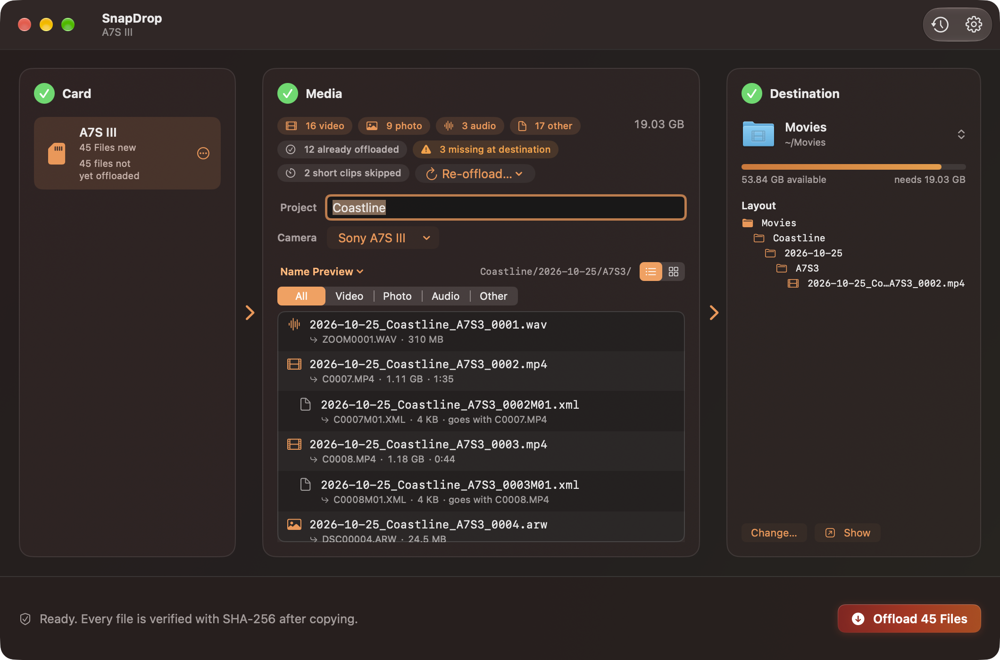 |

## Thumbnails and Quick Look

The switch above the Media list (☰ / ▦) shows the files as a **list** or a **thumbnail
grid**; Lodge remembers your choice. In the grid each tile has a thumbnail, the new name
(shortened in the middle), the clip's length, its type, and a "+1" paperclip for sidecars
that travel with it. While copying, the current tile shows a progress ring and verified
tiles get a green tick; files offloaded before are dimmed, missing copies get a warning, and
skipped short clips are striped with **Include Anyway** in their right-click menu. The
filter and right-click menus work the same in both views. **Settings → Appearance →
Show thumbnails in the list** adds small thumbnails to list rows too.

Thumbnails come from Quick Look, are made in the background (four at a time, one at a time
while copying), are cached by path, size and modification date, and are only ever *read*
from the card. Formats Quick Look can't draw (BRAW, R3D, MXF, XML…) show a symbol instead.

**Quick Look:** select files and press **Space** (or double-click, or right-click →
**Quick Look**). The arrow keys move through the files in the order shown, following the
filter; with several files selected (⌘-click, ⇧-click) the panel steps through just those.
Files Quick Look can't open show *No preview available for .braw*.

| Grid | Grid (Light Mode) |
| --- | --- |
| 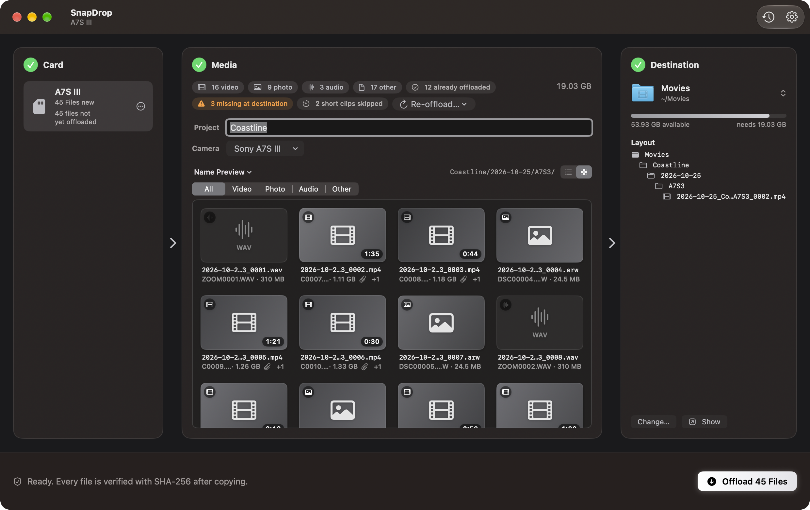 | 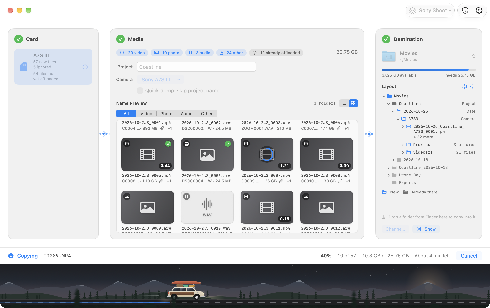 |

## Skipping short clips

Accidental takes — a clip you started and stopped right away — don't need to be offloaded.
With **Settings → General → Skip videos shorter than** set to **5 s** (the default) those
videos stay on the card, together with their sidecars. The slider goes from *Off* to 30 s
and the stepper next to it up to 60 s. The
Media panel shows *2 short clips skipped*; click it to see them and choose **Include
Anyway** for one or **Include All** for every one. Clips whose length can't be read (BRAW,
R3D) are always offloaded.

A card whose only remaining files are skipped short clips can still be formatted — the
button then reads **Format and Discard N Short Clips**, so it's clear they'll be lost.

## Re-offloading

Offloaded files aren't copied again, but sometimes you want them to be: a copy was deleted
from the destination, or you want a second copy somewhere else. **Re-offload…** in the
Media panel offers:

- **Re-offload Missing Copies** — files the ledger has but whose copy is gone or changed
  size (shown as *3 missing at destination*).
- **Re-offload Everything on This Card…** — copy the whole card again.
- Per file, from the right-click menu: **Re-offload This File** / **Don't Re-offload**.

Re-offloaded files are marked *re-offload* and always land as new copies; nothing existing
is ever overwritten. The card's **…** menu also has **Forget This Card's History…**, which
clears the ledger for that card so everything on it counts as new.

## Formatting a card

When every file on a card has been copied and verified, the card shows a green
**Ready to format** badge (otherwise it says how many files aren't offloaded yet).
"Offloaded" means the ledger has the file *and* its copy is still in the destination with
the right size — if you've moved or deleted copies, the card isn't ready.

**Format Card…** (in the card's **…** menu, its right-click menu, or after an offload)
asks first, with **Cancel** as the default button:


Formatting keeps the card's file system (exFAT, FAT32 or FAT16) and its name, using
`diskutil eraseVolume`. Before erasing, Lodge checks again that the card is still ready
and refuses unless the volume:

- is the card it scanned, mounted under `/Volumes`, and is a volume on a disk (not a whole
  disk);
- is removable media (an SD card in the built-in reader or a card reader) — never the
  startup disk or another drive that's part of your Mac;
- isn't the drive your destination folder is on.

If *Eject card after offload* is on, the card is ejected after formatting. Tip: formatting
in the camera is usually best, because it sets the card up exactly the way the camera
expects.

## Favorite destinations

Keep a list of places you offload to — "Movies", "Footage SSD", "Client Archive" — and
switch with one click: click the folder in the **Destination** panel to see your favorites
with their free space, plus **Choose Other Folder…** and **Edit Favorites…**. A favorite on
a drive that isn't plugged in shows *Not connected* and can't be picked until it's back.

Manage them in **Settings → Destinations**: add (+), remove (−), rename (click the name
and type), **Change Folder…**, drag to reorder and **Make Default**. Lodge starts with the
favorite you used last (or the default). The list is saved in
`~/Library/Application Support/Lodge/destinations.json`, with a bookmark for each
folder so a folder that's renamed or moved is still found.

## Presets

A preset is a saved setup you switch to in one click from the toolbar menu at the top
right, next to Recent Offloads and Settings ("Drone Day", "Client B-Roll"): the destination, the folder and file templates, the
camera, the short-clip setting, quick dump and the file rules. **Save Current Setup as
Preset…** makes one from what the main window uses now; if you change something afterwards
the menu says *Edited* and offers **Update “Name”**. Manage them in **Settings → Presets**.

## Quick dump

**Quick dump: skip project name** (under the Camera field) is for just getting the footage
off a card. `{project}` is taken out of both templates cleanly — `{date}/{project}` +
`{date}_{project}_{seq}` become `{date}` + `{date}_{seq}` — so there's no project to type.
Numbering carries on from what's already in the folder.

## Settings (⌘,)

**General** — which [file types](#file-types) to offload (all on by default);
[*Skip videos shorter than*](#skipping-short-clips); *Eject card after
offload* (off by default, and only when every file copied and verified); *Play a sound when
an offload finishes* (on by default); *Automatically check for updates* (on) and
*Automatically download and install updates* (off), see [Updates](#updates).

**Appearance** — see [Themes and appearance](#themes-and-appearance).

**Presets** — see [Presets](#presets).

**Files** — which extensions are proxies (`lrv lrf`, copied into a *Proxies* folder) and
sidecars (`thm xml srt`, into a *Sidecars* folder), and the ignore list of files that are
never offloaded (`.DS_Store`, `._*`, `.Spotlight-V100`, …). Both folders sit next to the
clips and their files keep their clip's new name.

**Naming** — a folder template and a file template, presets, and a live example.
Click a token chip to insert it where you were typing. Mistakes (an unclosed `{`, an
unknown token, `{seq}` twice, a name starting with `.`) are explained right under the field
and the Offload button stays off until they're fixed. **Reset to Default** brings back
`{date}/{project}` + `{date}_{project}_{seq}`.

| Token | Becomes |
| --- | --- |
| `{project}` | Project name from the main window ("Beach Shoot" → `BeachShoot`; recent projects are one click away) |
| `{camera}` | The chosen camera's short code, or its name if it has no code |
| `{date}` | Capture date, `2026-10-25` |
| `{year}` `{month}` `{day}` | `2026`, `10`, `25` |
| `{time}` | Capture time, `143005` |
| `{type}` | `Video`, `Photo`, `Audio` or `Other` |
| `{card}` | The card's volume name |
| `{original}` | The original file name without extension, `C0001` |
| `{seq}` | Sequence number, `0001`; `{seq:3}` gives `001` |
| `{ext}` | File extension, `mp4` (the real extension is always added at the end) |

Use `/` in the folder template for subfolders. Presets: *Date / Project* (default),
*Project / Date / Camera*, *Project / Type / Date*, *Year / Month / Day*,
*Date / Project, Original Names*, and *Flat*. Older versions had a separate **Shoot**
field and `{shoot}` token; they're now one. `{shoot}` still works as another name for
`{project}`, and saved templates are updated automatically (`{date}/{shoot}` becomes
`{date}/{project}`, and a doubled `{project}_{project}` collapses to one). Without `{seq}` or `{original}`, files that
would end up with the same name get `_2`, `_3`… instead of overwriting.

**Cameras** — your list of cameras, each with a name ("Sony FX3") and an optional short
code ("A") used by `{camera}`. Add, rename, reorder (drag) and delete. In the main window
pick one from the **Camera** menu; Lodge remembers which camera you used with each card
and picks it again next time. *Edit Cameras…* in that menu jumps straight here.

**Destinations** — your [favorite destinations](#favorite-destinations).

| General | Naming | Cameras | Destinations |
| --- | --- | --- | --- |
| 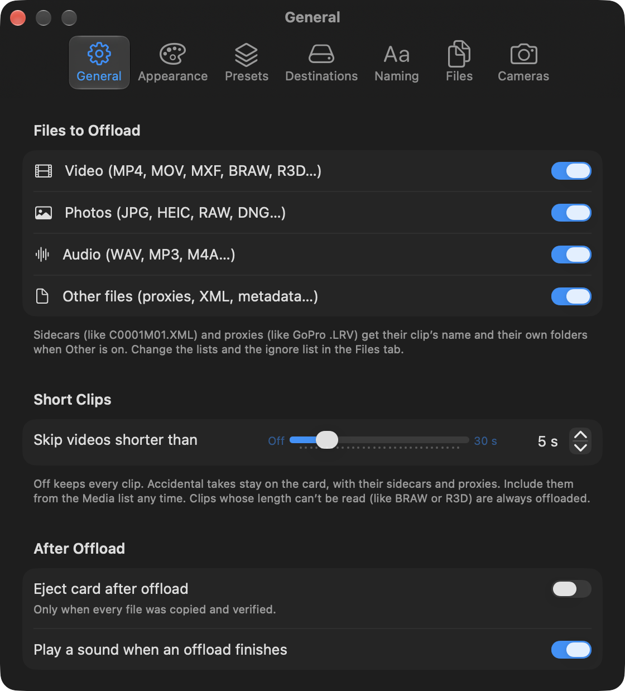 | 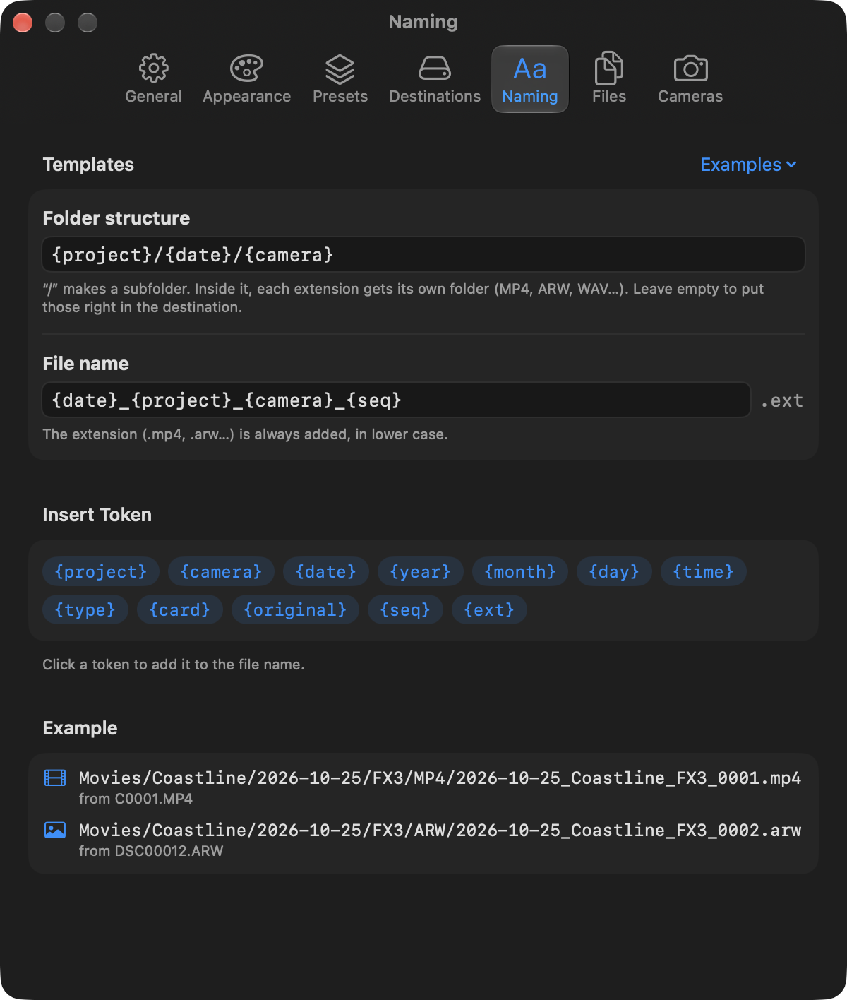 | 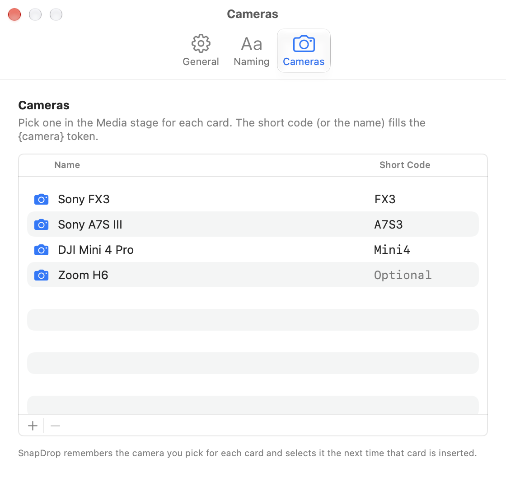 | 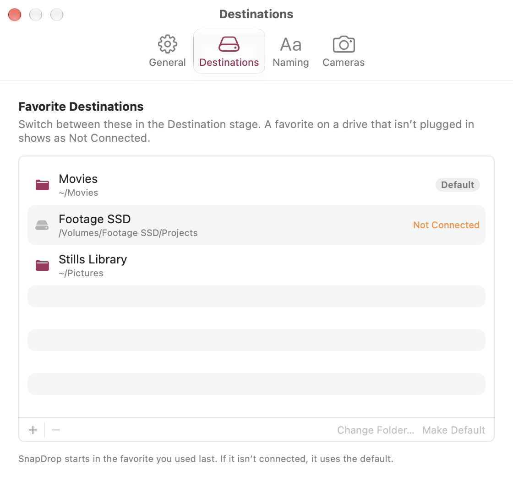 |

### Themes and appearance

**Settings → Appearance** has the theme, Light / Dark / System, and how the Media files are
shown.

- **Default** (the default) is a neutral window with no coloured wash and the system accent
  colour (blue unless you've picked another) on every control.
- **Aurora**, **Ocean**, **Twilight**, **Ember** and **Forest** are optional colour
  gradients: a soft wash behind the window, the gradient **Offload** button, the progress
  bar, the glowing border of the step that needs you, the dots flowing between steps and the
  glow when an offload completes.
- **Appearance** is **Dark** unless you pick Light or System.

With **Increase contrast** or **Reduce transparency** turned on, every theme uses solid
colours instead of gradients. Every theme is tuned separately for Light and Dark and keeps
button text readable (checked by `ThemeTests`). The palettes live in one place,
`Theme.swift`; the asset catalog's `AccentColor` is system blue, used by AppKit controls when
the system accent is Multicolor and as the fallback outside SwiftUI. A saved "Comet" or
"Graphite" theme from an older version becomes Default.

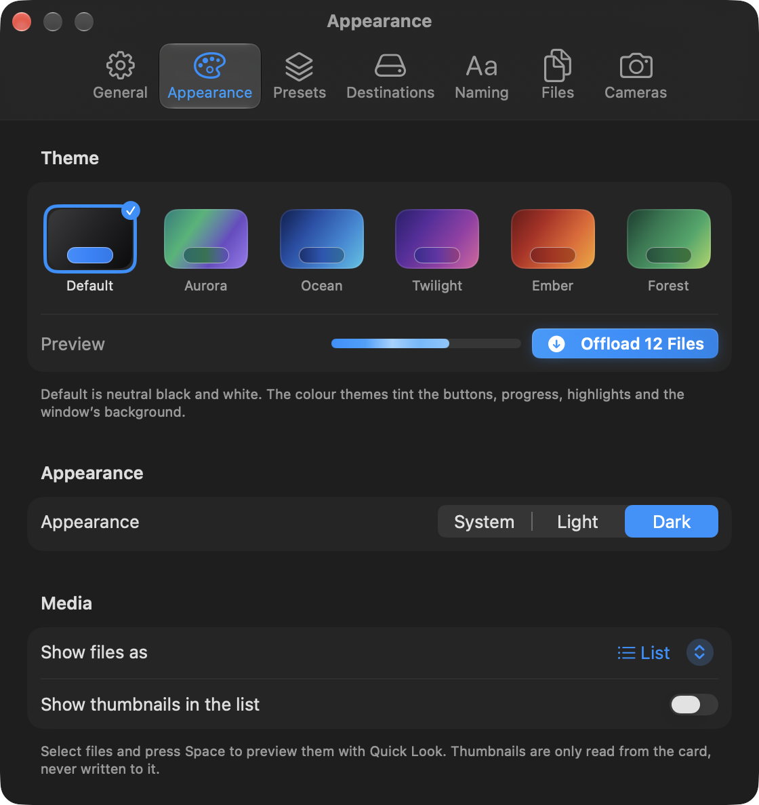

## File types

The type comes from the file extension (upper or lower case).

| Type | Extensions |
| --- | --- |
| Video | `mp4 mov mxf braw r3d crm mts m2ts avi mkv insv lrv 360` |
| Photo | `jpg jpeg heic heif png tif tiff dng arw cr2 cr3 nef raf orf rw2 srw pef gpr insp` |
| Audio | `wav mp3 aac m4a bwf` |
| Other | everything else (`xml`, `lrf`, `thm`, …) |

- **Sidecars** keep their clip's new name: an audio or other file next to a video or photo
  with the same name (`GX010001.WAV` → `…_0001.wav`), or Sony's `C0001M01.XML` style
  (`…_0001M01.xml`). They don't use up a sequence number.
- **Never copied:** anything starting with `.` (`.DS_Store`, `._C0001.MP4`,
  `.Spotlight-V100`, `.fseventsd`, `.Trashes`, `.TemporaryItems`…), `System Volume
  Information`, `$RECYCLE.BIN`, `Thumbs.db`, `desktop.ini`. Empty (zero-byte) files that
  aren't hidden are copied.

## Updates

Lodge checks for new versions once a day with [Sparkle](https://sparkle-project.org),
using the feed in [`appcast.xml`](appcast.xml), and offers to install them. Choose
**Lodge ▸ Check for Updates…** to check now, or turn the checks off in Settings ▸ General.
Updates are signed, so Lodge only installs ones you published. How to publish one:
[docs/RELEASING.md](docs/RELEASING.md). (1.0.0 predates Sparkle and can't update itself.)

## Run it

1. Open `Lodge.xcodeproj` in Xcode (double-click it).
2. Press **⌘R**.
3. First run: click **Choose Folder…** in the *Destination* panel (or in Settings, ⌘,) and
   pick the folder for your footage. It's remembered from then on.
4. Insert a card, fill in the project name (and camera if your template uses it),
   and click **Offload N Files**.

The project builds without an Apple developer account ("Sign to Run Locally" /
ad-hoc signing). The app is not sandboxed so it can read `/Volumes` and write to any
folder you pick.

### First-launch notes

- macOS may ask *"Lodge would like to access files on a removable volume"* the first
  time it reads a card. Click **Allow**. (If you clicked Don't Allow, turn it back on in
  System Settings → Privacy & Security → Files and Folders.)
- If you copy the built `Lodge.app` somewhere and open it outside Xcode, Gatekeeper may
  block it because it isn't notarized. Right-click the app → **Open** → **Open**
  (or System Settings → Privacy & Security → *Open Anyway*).
- Closing the window quits Lodge. Keep it open while you work so it can catch cards.

## Build from the command line

```sh
DEVELOPER_DIR=/Applications/Xcode.app/Contents/Developer \
  xcodebuild -project Lodge.xcodeproj -scheme Lodge -configuration Debug \
  -derivedDataPath build/DerivedData CODE_SIGNING_ALLOWED=NO build

# unit tests
DEVELOPER_DIR=/Applications/Xcode.app/Contents/Developer \
  xcodebuild -project Lodge.xcodeproj -scheme Lodge \
  -derivedDataPath build/DerivedData test
```

### Demo mode (Debug builds only)

To see the UI without a card, launch the Debug build with sample data. It never touches
your real settings or ledger:

```sh
open -n build/DerivedData/Build/Products/Debug/Lodge.app --args \
  -LodgeDemo YES -LodgeDemoState ready -LodgeDemoAppearance dark
```

States: `empty`, `ready`, `running`, `finished`. Appearance: `light` or `dark`.
Add `-LodgeDemoSettingsTab general|appearance|presets|destinations|naming|files|cameras` to open Settings on that
tab, `-LodgeDemoTheme ember` (or `default`, `aurora`, `ocean`, `twilight`, `forest`) for a
theme, `-LodgeDemoLayout grid` for the thumbnail grid (`-LodgeDemoListThumbnails YES`
for list thumbnails), `-LodgeDemoScope skipped|offloaded` to show the skipped short clips
or the files offloaded before, `-LodgeDemoQuickLook C0008.MP4` to open Quick Look on a file,
`-LodgeDemoFolderTemplate '{project}_{date}/{camera}/{type}'` to use another folder template,
`-LodgeDemoAbout YES` to open the About window,
`-LodgeDemoExpandTree YES` (or `files`) to open the whole Layout tree (and its file lists),
`-LodgeDemoWindowSize 1060x700` to size the window (centred on the sharpest screen), `-LodgeDemoShowFormatAlert YES` to show the Format confirmation, or
`-LodgeDemoPlainTheme YES` to see the solid colours used with Increase contrast. Demo windows
are drawn as if they were active, so screenshots taken with the app in the background still
show the accent colour on switches and segments.
Formatting can never run in demo mode.
The sample card has clips with Sony XML sidecars, RAW photos, WAVs, two short clips, a few
missing copies and a few cameras; thumbnails are drawn placeholders in the theme's colours.
Every view also has `#Preview`s you can open in Xcode's canvas.

## Code tour

| File | What's in it |
| --- | --- |
| `LodgeApp.swift` | App entry point: main window, Settings scene and Check for Updates… |
| `Updates.swift` | Sparkle updater, the Check for Updates… menu item and the update settings |
| `AppModel.swift` | Ties settings, cameras, destinations, card watcher, ledger and the current offload together; eject, format, sound |
| `Theme.swift` | Themes (Default and the colour gradients), window wash and prominent button style, with solid fallbacks |
| `ContentView.swift` | Main window: the Card → Media → Destination funnel and toolbar |
| `FunnelComponents.swift` | Shared pieces: stage panel, step badge, arrows, count pills |
| `Motion.swift` | Animated pieces: arrow stream, shimmering progress bar, completion burst, drawn checkmark, count-up numbers, hover lift, row reveal, drop haptics |
| `CardStageView.swift` | ① Card panel, Ready to format badge, card actions menu |
| `ClipsStageView.swift` | ② Media panel: counts, project/camera, filterable list or grid, selection, re-offload and short-clip controls |
| `MediaGridViews.swift` | Grid tiles, thumbnails, status badges, progress ring, list/grid switch |
| `MediaPreview.swift` | Selection, Quick Look order and panel, sidecar folding for the grid |
| `Thumbnails.swift` | Quick Look thumbnail loading: cache, concurrency limit, cancellation, supported types |
| `DestinationStageView.swift` | ③ Destination panel: favorites picker, free space |
| `FolderTreeView.swift` | The expandable Layout tree, drag-and-drop levels and side-by-side tokens |
| `FolderTree.swift` | The planned folders as a tree, and the folders already on disk |
| `InlineLevel.swift` | Tokens side by side in one folder level (`{project}_{date}`) and their edits |
| `FormatViews.swift` | Format confirmation, Ready to format badge, format status and buttons |
| `OffloadBar.swift` | Bottom bar: Offload button, progress/ETA/Cancel, completion actions |
| `RecentOffloadsView.swift` | Recent Offloads popover |
| `SettingsView.swift` | Settings window (⌘,): tabs and the General tab |
| `NamingSettingsView.swift` | Naming tab: template editors, presets, token chips, example |
| `CamerasSettingsView.swift` | Cameras tab |
| `DestinationsSettingsView.swift` | Destinations tab |
| `NamingTemplate.swift` | Template tokens, parsing/validation, presets, rendering |
| `FileRules.swift` | Proxy and sidecar extensions and the ignore list (Settings → Files) |
| `QuickDump.swift` | Takes `{project}` out of the templates for a quick dump |
| `OffloadPreset.swift` | Saved setups: destination, templates, camera, short clips, quick dump, file rules |
| `PresetViews.swift` | The toolbar preset switcher, Settings → Presets and Files, the short-clip slider |
| `OffloadPlanner.swift` | Turns files + templates into final paths; sequence numbers; sidecar matching |
| `MediaCategory.swift` | Video / Photo / Audio / Other by extension |
| `CameraStore.swift` | The camera list and per-card camera memory (`cameras.json`) |
| `DestinationStore.swift` | Favorite destinations, default / last used, connected or not (`destinations.json`) |
| `CardFormatter.swift` | Ready-to-format check, the safety checks, and `diskutil eraseVolume` |
| `FlowLogic.swift` | Pure logic for the UI: "why is Offload disabled", ETA and byte text, success feedback |
| `DemoData.swift` | Sample data for previews and demo mode (Debug only) |
| `OffloadSession.swift` | State for one card's offload; runs the copy in the background |
| `VolumeWatcher.swift` | Detects cards being inserted/removed |
| `ClipScanner.swift` | Finds media on a card, skipping system junk |
| `Renamer.swift` | Project-name cleanup and date formatting |
| `Copier.swift` | Copy + SHA-256 verify of one file, and the whole-card offload loop |
| `Ledger.swift` | The JSON record of everything offloaded |
| `LegacyMigration.swift` | First launch: copies the old app’s Application Support files and settings into Lodge’s (copy, never move) |
| `CardInventory.swift` | Every file on a card sorted by what the ledger knows: new, offloaded, or missing at the destination |
| `ReoffloadAlert.swift` | The Re-offload Everything and Forget This Card's History confirmations |
| `ShortClips.swift` | The short-clip rule: reading clip lengths, what's skipped and what's included anyway |
| `Settings.swift` | Preferences: destination, templates, file types, short clips, eject, sound, theme, appearance, media layout, recent projects |
| `Assets.xcassets/AppIcon` | App icon sizes: the hand-made night "Lodge Cabin" set from `Design/lodge-cabin-night/` |
| `Design/lodge-cabin-night/` | Night "Lodge Cabin" icon set (v5 B), as delivered: one PNG per icon slot, its `Contents.json`, `icon_1024.png`, and the masters `lodge-cabin.svg` and `lodge-cabin-small.svg` |
| `Design/icon-1024.png` | Master app icon (night Lodge Cabin, 1024×1024) |
| `Design/lodge-cabin-sunset/` | The previous sunset "Lodge Cabin" icon set, archived, with its 2400×800 header images `lodge-header-dark.png` and `lodge-header-light.png` |
| `Design/dusk-cabin-v3/` | The previous "Dusk Cabin" (v3) icon set, archived |
| `Design/comet-a-v3/` | The previous "Comet A" (v3) icon set, archived |
| `Design/comet-a-v1/`, `Design/comet-a-v2/` | Earlier Comet A drafts, kept for reference |
| `Design/icon-legacy-blue.png`, `.svg` | The previous blue icon, kept for reference |
| `Design/screenshots/` | Screenshots of the app (taken from demo mode) |
| `LodgeTests/` | Unit tests: templates, planner, sidecars, file types, junk skipping, cameras, ledger, copy/verify, end-to-end fake cards, format readiness and safety checks (with a fake `diskutil`), favorite destinations, themes and their migration, re-offload, short clips, thumbnails and Quick Look order |

The project uses Xcode's folder-synced groups: any `.swift` file you add to the
`Lodge/` folder is automatically part of the app (except `Lodge/Info.plist`, which holds
the Sparkle keys). The one third-party dependency is
[Sparkle](https://github.com/sparkle-project/Sparkle) 2, added with Swift Package Manager.

## Updating the icon

The icon is the night "Lodge Cabin" (v5 B): a snow-roofed log cabin with lit windows and
chimney smoke under a starry night sky. The set in `Design/lodge-cabin-night/` is used
exactly as delivered; `lodge-cabin.svg` is the master for the large sizes and
`lodge-cabin-small.svg` the simplified one for the small sizes.

Each size is drawn by hand. The 16×16, 16×16@2x and 32×32 versions come from the
simplified small master that stays readable in the menu bar and Finder lists, so
**don't generate the sizes by scaling one image with `sips`**. To update it:

1. Put the new set in `Design/lodge-cabin-night/` (or a new folder) with these names:
   `icon_16x16.png`, `icon_16x16@2x.png`, `icon_32x32.png`, `icon_32x32@2x.png`,
   `icon_128x128.png`, `icon_128x128@2x.png`, `icon_256x256.png`, `icon_256x256@2x.png`,
   `icon_512x512.png`, `icon_512x512@2x.png`, plus `icon_1024.png`.
2. Copy them into the asset catalog and refresh the master copy:

```sh
cp Design/lodge-cabin-night/icon_*x*.png Lodge/Assets.xcassets/AppIcon.appiconset/
cp Design/lodge-cabin-night/icon_1024.png Design/icon-1024.png
```

`Contents.json` already points each slot at the file with the same name. The previous
icons are archived in `Design/lodge-cabin-sunset/` (the sunset Lodge Cabin),
`Design/dusk-cabin-v3/` (Dusk Cabin) and `Design/comet-a-v1/` … `v3/` (Comet A).

## License

MIT — see [LICENSE](LICENSE).
