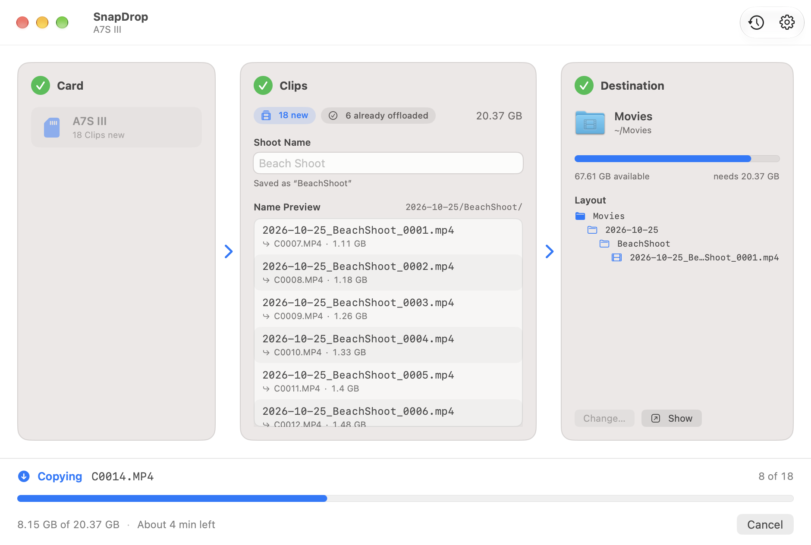

# SnapDrop

A small native macOS app (SwiftUI) that offloads video clips from camera SD cards —
safely, verified, and neatly named.


## What it does

1. **Notices when you insert a card.** Any removable drive mounted under `/Volumes`
   that has video clips on it (cards already inserted at launch count too).
2. **Finds your clips** in the usual camera folders — `DCIM` (all cameras),
   `PRIVATE/M4ROOT/CLIP` (Sony), `CONTENTS/CLIPS` (Panasonic) — and searches the whole
   card if none of those exist. File types: `.mp4`, `.mov`, `.mxf`, `.braw`.
   Hidden files and macOS `._` junk files are ignored.
3. **Asks for a shoot name.** "Beach Shoot" becomes `BeachShoot`. A live preview shows
   exactly what every clip will be called before anything is copied.
4. **Copies only new clips** into dated subfolders of your destination:

   ```
   Destination/
     2026-10-25/
       BeachShoot/
         2026-10-25_BeachShoot_0001.mp4
         2026-10-25_BeachShoot_0002.mov
   ```

   - The date is the clip's creation date (or modification date if there's none).
   - Numbers continue after the highest one already in that folder, so a second card
     from the same shoot picks up at `_0003`. Nothing is ever overwritten.
   - Extensions are lowercased.
5. **Verifies every copy** with SHA-256. Each clip is first copied to
   `<name>.snapdrop-partial`, the copy is re-read from disk and hashed, and only when it
   matches the source is it renamed to its final name. A mismatch deletes the partial
   file and is reported as a failure.
6. **Remembers what it copied** in a ledger at
   `~/Library/Application Support/SnapDrop/ledger.json`, so inserting the same card
   again only copies clips that are new. A clip is identified by the card's volume UUID
   (or name) + its path on the card + size + modification time.

SnapDrop **never changes or deletes anything on the card.**

## The window

The main window reads left to right, like a funnel:

**① Card → ② Clips → ③ Destination**, with the offload bar along the bottom.

- **Card** — the inserted cards. Pick one if more than one is mounted.
- **Clips** — how many clips are new vs. already offloaded, the shoot name field, and a
  live name preview (`C0007.MP4` → `2026-10-25_BeachShoot_0001.mp4`).
- **Destination** — the folder, its free space, and the folder layout clips will land in.
- **Offload bar** — the big **Offload N Clips** button. When it's disabled it tells you why
  ("Enter a shoot name", "Not enough space…"). While copying it shows the current file,
  *X of N*, bytes copied, time left and a *Verifying* state, plus **Cancel**. When it's
  done: **Show in Finder**, **Eject Card** and **Done**.

When you insert a card SnapDrop fills in the funnel and brings its window to the front —
no pop-up sheet. The clock button in the toolbar shows **Recent Offloads**.

### Settings (⌘,)

- **Destination folder**
- **Eject card after offload** (off by default) — only ejects when every clip copied and
  verified with no failures.

| Ready | Copying | Finished (Dark Mode) |
| --- | --- | --- |
|  |  |  |

## Run it

1. Open `SnapDrop.xcodeproj` in Xcode (double-click it).
2. Press **⌘R**.
3. First run: click **Choose Folder…** in the *Destination* panel (or in Settings, ⌘,) and
   pick the folder for your footage. It's remembered from then on.
4. Insert a card, type a shoot name, and click **Offload N Clips**.

The project builds without an Apple developer account ("Sign to Run Locally" /
ad-hoc signing). The app is not sandboxed so it can read `/Volumes` and write to any
folder you pick.

### First-launch notes

- macOS may ask *"SnapDrop would like to access files on a removable volume"* the first
  time it reads a card. Click **Allow**. (If you clicked Don't Allow, turn it back on in
  System Settings → Privacy & Security → Files and Folders.)
- If you copy the built `SnapDrop.app` somewhere and open it outside Xcode, Gatekeeper may
  block it because it isn't notarized. Right-click the app → **Open** → **Open**
  (or System Settings → Privacy & Security → *Open Anyway*).
- Closing the window quits SnapDrop. Keep it open while you work so it can catch cards.

## Build from the command line

```sh
DEVELOPER_DIR=/Applications/Xcode.app/Contents/Developer \
  xcodebuild -project SnapDrop.xcodeproj -scheme SnapDrop -configuration Debug \
  -derivedDataPath build/DerivedData CODE_SIGNING_ALLOWED=NO build

# unit tests
DEVELOPER_DIR=/Applications/Xcode.app/Contents/Developer \
  xcodebuild -project SnapDrop.xcodeproj -scheme SnapDrop \
  -derivedDataPath build/DerivedData test
```

### Demo mode (Debug builds only)

To see the UI without a card, launch the Debug build with sample data. It never touches
your real settings or ledger:

```sh
open -n build/DerivedData/Build/Products/Debug/SnapDrop.app --args \
  -SnapDropDemo YES -SnapDropDemoState ready -SnapDropDemoAppearance dark
```

States: `empty`, `ready`, `running`, `finished`. Appearance: `light` or `dark`.
Every view also has `#Preview`s you can open in Xcode's canvas.

## Code tour

| File | What's in it |
| --- | --- |
| `SnapDropApp.swift` | App entry point: main window and Settings scene |
| `AppModel.swift` | Ties settings, card watcher, ledger and the current offload together; eject |
| `ContentView.swift` | Main window: the Card → Clips → Destination funnel and toolbar |
| `FunnelComponents.swift` | Shared pieces: stage panel, step badge, arrows, count pills |
| `CardStageView.swift` | ① Card panel |
| `ClipsStageView.swift` | ② Clips panel: counts, shoot name, live name preview |
| `DestinationStageView.swift` | ③ Destination panel: folder, free space, layout |
| `OffloadBar.swift` | Bottom bar: Offload button, progress/ETA/Cancel, completion actions |
| `RecentOffloadsView.swift` | Recent Offloads popover |
| `SettingsView.swift` | Settings window (⌘,) |
| `FlowLogic.swift` | Pure logic for the UI: name preview, "why is Offload disabled", ETA and byte text |
| `DemoData.swift` | Sample data for previews and demo mode (Debug only) |
| `OffloadSession.swift` | State for one card's offload; runs the copy in the background |
| `VolumeWatcher.swift` | Detects cards being inserted/removed |
| `ClipScanner.swift` | Finds clips on a card |
| `Renamer.swift` | Shoot-name cleanup, file/folder naming, sequence numbers |
| `Copier.swift` | Copy + SHA-256 verify of one file, and the whole-card offload loop |
| `Ledger.swift` | The JSON record of everything offloaded |
| `Settings.swift` | Preferences: destination folder, eject after offload |
| `Assets.xcassets/AppIcon` | App icon sizes, generated from `Design/icon-1024.png` |
| `Design/icon-1024.png`, `Design/icon.svg` | Master app icon (PNG + vector source) |
| `Design/screenshots/` | Screenshots of the app (taken from demo mode) |
| `SnapDropTests/` | Unit tests for naming, filtering, ledger, copy/verify, name preview and ETA/byte text |

The project uses Xcode's folder-synced groups: any `.swift` file you add to the
`SnapDrop/` folder is automatically part of the app. No third-party dependencies.

## Updating the icon

Replace `Design/icon-1024.png` (1024×1024, already macOS-shaped), then regenerate the sizes:

```sh
cd SnapDrop/Assets.xcassets/AppIcon.appiconset
for s in 16 32 64 128 256 512 1024; do sips -z $s $s ../../../Design/icon-1024.png --out icon_$s.png; done
```

## License

MIT — see [LICENSE](LICENSE).
