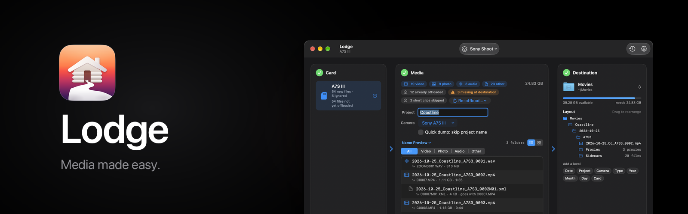

  <picture>
    <source media="(prefers-color-scheme: light)" srcset="docs/assets/lodge-header-light.png">
    <source media="(prefers-color-scheme: dark)" srcset="docs/assets/lodge-header-dark.png">
    
  </picture>

<h1 align="center">From card to calm.</h1>

  Lodge gets your footage off camera cards safely, checked and neatly named.

- Copies each file off the card and checks it with SHA-256.
- Names files from a template, and skips what is already copied.
- Shows how many trial days are left. After the trial, Buy in the app leads to Polar.

## Download and install

[Try free 3 days, then $10](https://bashcrandicoot.github.io/Lodge/)

## Privacy

No account, no analytics, and copying never uploads anything. Lodge goes online for a daily update check, which you can turn off in Settings > General, and to activate your license with Polar and confirm it about once a week.

## Support

Write to [bashframes@gmail.com](mailto:bashframes@gmail.com). If Lodge has been useful, [Support Lodge](https://ko-fi.com/bashframes).

[Security](SECURITY.md) · [License](LICENSE)

© 2026 bashframes
