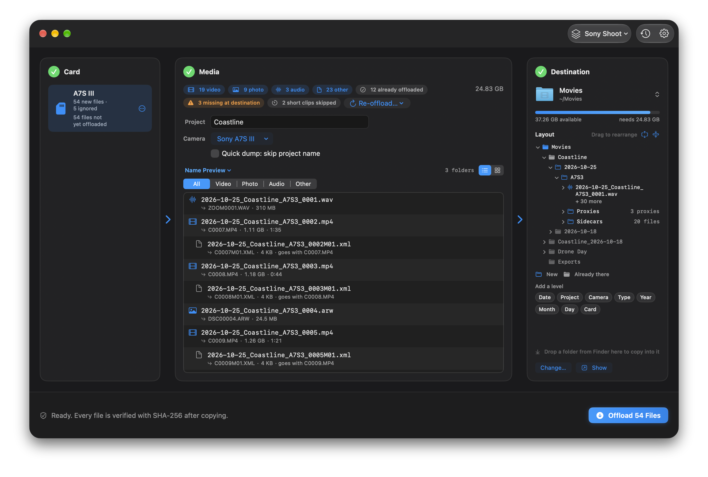
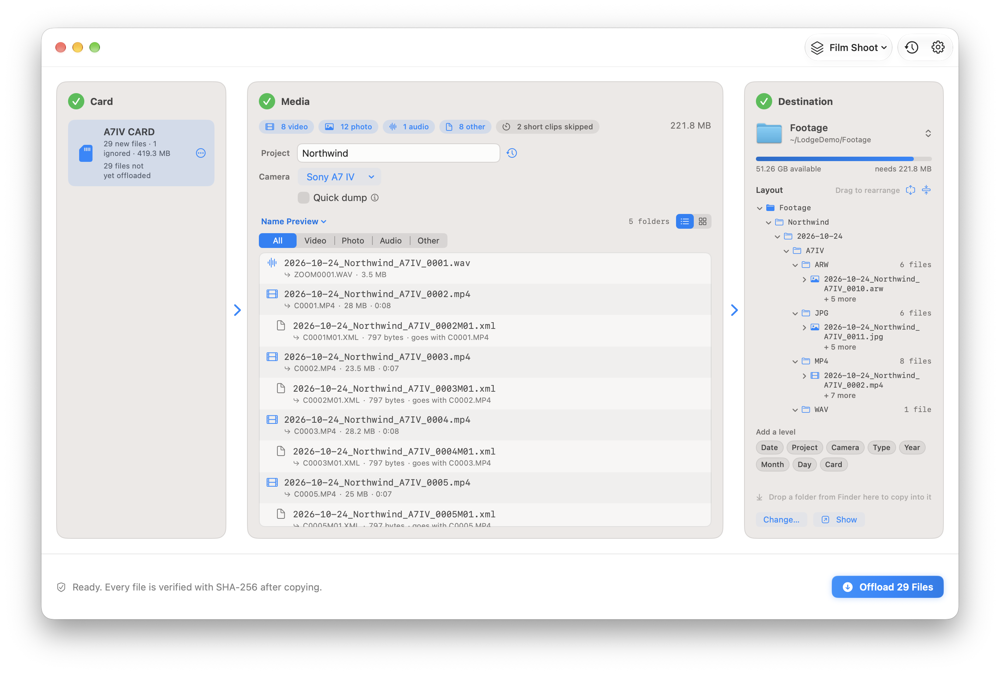
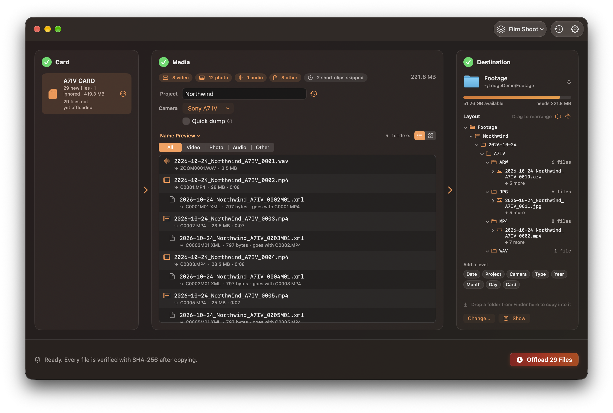

# User guide

Lodge copies your footage off a camera card or drive, names each file for you, and checks every copy with SHA-256. Plugging in a card does not start a copy. **Import** only opens Lodge with that card selected. Nothing is copied until you click **Offload N Files** (**Offload 1 File** for one file, or **Offload Files** when nothing is ready).

## Install and first launch

**$10 once via Polar.** [Buy Lodge](https://buy.polar.sh/polar_cl_gS9NEtdIPJuJDXu8sdui02XetKbkwKuHgiYxi4FBkM1). Open the .dmg, and drag Lodge to Applications.

Lodge requires macOS 14.0 or later. It isn't notarized yet, which is why **Open Anyway** is needed the first time you open it.

### macOS 15 Sequoia and later

1. Open Lodge.
2. Click **Done** on the warning.
3. Go to **System Settings > Privacy & Security**.
4. Click **Open Anyway** next to Lodge, and confirm.

### macOS 14 Sonoma

1. Right-click or Control-click Lodge.
2. Choose **Open**.
3. Choose **Open** again.

During setup, Return is **Next: …** and **Save preset**. The done screen has **Open Settings**, **Open Lodge**, and **Skip setup**. You can open Settings any time with ⌘,.

During setup, each drive shows how much space is available.

## Your first offload

### When Lodge asks to import

Lodge asks **Import with Lodge?** when you plug in a camera card or a removable drive. It won't ask about your startup disk, a network or backup drive, a disk image, the drive you copy to, or a card you've told it to skip.

Lodge recognizes the folders most cameras use (for example `DCIM`, `PRIVATE/M4ROOT`, `XDROOT`, and `CLIPS001`).

Lodge waits 20 seconds before it asks about the same card again. If you plug a card in during an offload or a format, Lodge asks when that finishes.

The notification has three actions: **Import**, **Ignore**, and **Don’t Ask for This Card**.

Lodge shows the same prompt as a floating panel when alerts are off, the notification style is **None**, or **Ask with** is **Floating panel**. Its buttons are **Import** (Return), **Ignore**, and **Don’t ask for this card**.

If you don't see the prompt, set **Settings ▸ Ask with** to **Floating panel**.

**Import** opens Lodge with that card selected. Nothing is copied yet. Notifications are the default.

If card detection is paused, choose **Resume Detection** in the menu bar menu. That does not resume an offload.

### Offload

1. Insert a card.
2. Enter a project name if the template needs one.
3. Choose a destination.
4. Click **Offload N Files**.

While Lodge is ready, the bar says **Ready. Every file is verified with SHA-256 after copying.** The button help is **Copy and verify the new files**. You'll see **Copying**, then **Verifying**.

You can also press Return to start.

If **Offload N Files** cannot start, its caption is one of the messages in [Why Offload is waiting](#why-offload-is-waiting).

## Verification

Lodge copies one file like this:

1. It writes `<final name>.lodge-partial` and hashes the source with SHA-256 as it reads.
2. It reads that partial file back from disk and hashes it.
3. If the hashes match, it renames the partial file to the final name. If they do not, it deletes the partial file.

Lodge never changes anything on your card, and it never overwrites a file that's already at the destination.

What you see when a file fails:

- **`<name>` already exists — not overwriting it.**
- **Couldn’t create `<name>` in the destination.**
- **Checksum mismatch for `<name>`. The copy was deleted.**

When the batch finishes, the title is **Offload Complete**, **Finished with Problems**, or **Offload Cancelled**.

The line under it is **`<copied>` copied · `<skipped>` skipped · `<failed>` failed**. If the card is already gone after an eject, that line gains ** — card ejected, safe to remove**.

If a copy Lodge expected is missing at the destination, Offload tells you to choose Re-offload. The wording is in [Re-offload](#re-offload).

## Naming templates and tokens

The default folder template is `{date}/{project}`. The default file template is `{date}_{project}_{seq}`.

To start from a ready-made template, choose **Examples** in Settings ▸ Naming. The choices are **Date / Project**, **Project / Date / Camera**, **Project / Type / Date**, **Year / Month / Day**, **Date / Project, Original Names**, and **Flat**.

| Token | Meaning in the template editor | Rendered value |
| --- | --- | --- |
| `{project}` | Project name | the project field |
| `{camera}` | Selected camera | the selected camera |
| `{date}` | Capture date (2026-10-25) | `yyyy-MM-dd` |
| `{year}` | Year (2026) | `yyyy` |
| `{month}` | Month (10) | `MM` |
| `{day}` | Day (25) | `dd` |
| `{time}` | Capture time (143005) | `HHmmss` |
| `{type}` | Video, Photo, Audio or Other | **Video**, **Photo**, **Audio**, or **Other** |
| `{card}` | Card (volume) name | the card’s name |
| `{original}` | Original file name, no extension | the source name, made safe |
| `{seq}` | Sequence number (0001); {seq:3} for 001 | at least 4 digits, unless `{seq:N}` says otherwise |
| `{ext}` | File extension (mp4) | the extension, lowercased |

In a file or folder name, `/`, `:`, `\`, `*`, `?`, `"`, `<`, `>`, `|`, and control characters become `-`. Spaces at the ends are trimmed, and leading dots are stripped so the name is not a hidden file.

The project name is cleaned separately. Letters, digits, and `-` stay. Any other character splits a word, and each word is capitalized, so "beach day" becomes `BeachDay`. The result is at most 60 characters, and leading or trailing `-` is removed.

Sequence numbers continue after the highest number already in the destination folder.

Lodge treats .jpeg and .jpe as .jpg, and .tiff as .tif.

## Presets and quick dump

A preset saves where files go, how they're named, the camera, short-clip skipping, quick dump, and the file rules. To save one, choose **Save Current Setup as Preset…** from the preset menu at the top right. With no preset chosen, the menu says **No Preset**.

On the setup done screen, Return can be **Offload with `<preset>`**.

Turn on **Quick dump** to skip the project name and copy everything straight into a dated folder. It is off until you turn it on.

## Sidecars and proxies

Proxies go in `Proxies/`. The default proxy extensions are `lrv` and `lrf`.

Sidecars go in `Sidecars/`. The default sidecar extensions are `thm`, `xml`, and `srt`.

They keep the clip’s new name.

By default, Lodge skips system files such as `.DS_Store`, `._*`, `.Spotlight-V100`, `.Trashes`, `.fseventsd`, `.TemporaryItems`, and `Thumbs.db`.

When a date filter is on, sidecars and proxies go with their clip. Everything else outside the chosen days stays on the card.

## Filtering by date and skipping short videos

**Dates** is **Any date** until you change it. The other choices are **Today**, **Last 7 days**, and **Custom range**.

The date-filter help says: **Copies only files from these days, by the date each file was created (or last changed, if the card doesn’t record that). Sidecars and proxies go with their clip. Everything else stays on the card.**

If the chosen days leave nothing new, Media shows **Nothing in These Dates**. Click **Show Any Date** to see everything. **Offload N Files** says **Nothing new in the chosen dates — choose Any date to see everything**.

**Short clips** skips videos shorter than the time you set. The slider runs from **Off** to **30 s**. The stepper beside it goes up to 60 seconds. The default is 5 seconds, with skipping on.

If the only videos left were skipped for length, Offload says one of:

- **Only a short clip is left — choose Include Anyway to offload it**
- **Only short clips are left — choose Include All Short Clips to offload them**

## Destinations and space

Until you pick a folder, the Destination stage shows **No Destination**. Click **Choose Folder…**, or drop a folder on it from Finder.

**Offload N Files** stays off, and says why, in these cases:

- **Choose a destination folder**
- **The destination folder isn’t connected — choose another**
- **Not enough space: needs `<needed>`, `<available>` free**

Each favorite shows how much space is available. A favorite that isn't plugged in says **Not connected**.

Under the destination, Lodge shows **`<bytes>` available**, and **needs `<bytes>`** once there's something to copy.

A read-only destination uses one of:

- **This drive is read-only, so Lodge can’t write to it — choose another** when Lodge has no format name
- **This drive is read-only (NTFS). macOS can’t write to it.**
- **This drive is read-only (`<format>`), so Lodge can’t write to it — choose another** for any other format

Format names Lodge recognizes are **NTFS**, **exFAT**, **FAT32**, **Mac OS Extended**, and **APFS**.

## Re-offload

When copies are missing at the destination, **Offload N Files** says:

- **1 copy is missing at the destination — choose Re-offload**
- **`<n>` copies are missing at the destination — choose Re-offload**

Click **Re-offload** to copy the missing files again. Lodge asks you to confirm first. There are two alerts:

- **Re-offload Everything** has no destructive button. Return is **Re-offload Everything**. **Cancel** is the other button.
- **Forget History** is destructive. Return is **Cancel**. **Forget This Card’s History…** in **Card actions** opens it.

## Eject or format the card

The manual command is **Eject Card**. After the card is gone, the label is **Ejected**.

**Eject Card** is disabled while an offload, a format, or an eject is in progress. On the finish bar it is disabled once the card has already been removed.

**Eject card after offload** is off. Its caption is **Only when every file was copied and verified.** Automatic eject runs only when that switch is on and every file verified. Lodge then ejects the card. After a successful eject, the finish line can end with ** — card ejected, safe to remove**. If eject fails, that line ends with ** — Couldn’t eject `<card name>`: `<system message>`**.

When every file on the card has a verified copy at the destination, the card shows **Ready to format**. That seal means every file on this card has a verified copy at the destination. Only then can you choose **Format Card…**, from **Card actions** (the ⋯ button on the card) or from the finish bar. Its help is **Erase this card so it’s ready for new footage**.

Choosing **Format Card…** does not erase the card by itself. Lodge erases it only after you confirm. **Formatting erases everything on the card, and you can't undo it.** Before you format, check that the offload says **Offload Complete** and not **Finished with Problems**. While it runs you'll see **Formatting…**. When it's done you'll see **“`<name>`” was formatted and is ready for your camera.**

On the format confirmation, Return is **Cancel**. **Format**, and **Format and Discard N Short Clips** when skipped clips would be erased, have no key. The title is **Format “`<card name>`”?**

## Menu bar mode

Turn on **Keep Lodge running in the menu bar** (off by default) so Lodge can watch for cards when its window is closed.

These sit with it:

| Setting | Default |
| --- | --- |
| Ask to import when a card or drive is plugged in | on |
| Show menu bar icon | on, and only shown while menu bar mode is on |
| Ask with | **Notification** (the other choice is **Floating panel**) |
| Open at login | off |

If **Open at login** won't stay on, allow Lodge in **System Settings ▸ General ▸ Login Items.**

The menu bar menu has:

- **Open Lodge**
- **Cards & Drives**, or **No Cards Connected** when nothing is mounted
- **Import from `<name>`…** for a connected card
- **Offloading…** while a copy is running. Imports wait until it is done.
- **Pause Detection**, or **Resume Detection** while detection is paused
- **Settings…** (⌘,)
- **Quit Lodge** (⌘Q)

**⌘-drag** the menu bar icon out to turn **Show menu bar icon** off. If the icon is hidden, the hint says to quit with **⌘Q**.

## Settings reference

Settings tabs are **General**, **Appearance**, **Presets**, **Destinations**, **Naming**, **Files**, and **Cameras**.

In Settings ▸ Appearance, pick a theme: **Default**, **Aurora**, **Ocean**, **Twilight**, **Ember**, or **Forest**. Then pick **System**, **Light**, or **Dark**. Lodge starts in **Dark**, with the **Default** theme.

**Show files as** is **List**. The other choice is **Grid**. **Show thumbnails in the list** is off.

General groups these sections: **Files to Offload**, **Short Clips**, **After Offload**, **Menu Bar**, and **Updates**. **Updates** appears only in builds that include the updater.

| Setting | Default |
| --- | --- |
| Destination folder | none, until you choose one |
| Eject card after offload | off |
| Folder template | `{date}/{project}` |
| File template | `{date}_{project}_{seq}` |
| Last project | empty |
| Recent projects | empty, and at most 6 |
| Files to offload | Video, Photos, Audio, and Other all on. The media filter says **Photo**. |
| Play a sound when an offload finishes | on |
| Short clips | On, 5 seconds. Slider from **Off** to **30 s**; the stepper goes to 60 seconds. |
| Theme | Default |
| Appearance | Dark |
| Show files as | List |
| Show thumbnails in the list | off |
| Quick dump | off |
| Dates | Any date |
| Keep Lodge running in the menu bar | off |
| Ask to import when a card or drive is plugged in | on |
| Show menu bar icon | on, while menu bar mode is on |
| Ask with | Notification |
| Open at login | off |
| Don’t ask for these cards | empty |
| Proxies | `lrv`, `lrf` |
| Sidecars | `thm`, `xml`, `srt` |
| Ignored names | `.DS_Store`, `._*`, `.Spotlight-V100`, `.Trashes`, `.fseventsd`, `.TemporaryItems`, `Thumbs.db` |
| Automatically check for updates | on |
| Update check interval | once a day |
| Automatically download and install updates | off |

The updates footer says: **Lodge checks for a new version once a day. You can also choose Lodge ▸ Check for Updates… any time.**

## Keyboard shortcuts

| Shortcut | What it does |
| --- | --- |
| ⌘, | Settings. The menu bar item uses the same key. The setup done screen shows **⌘ ,**. The Settings toolbar help is **Settings (⌘,)**. |
| ⌘Q | Quit. The hidden-icon hint says **quit it from there with ⌘Q.** |
| ⌘-drag | Drag the menu bar icon out to turn **Show menu bar icon** off. |
| Return | The default button: Offload, Done, **Import** on the floating panel, **Get started**, and **Offload with `<preset>`**. During setup, **Next: …** and **Save preset**. On the format confirmation and on **Forget History**, Return is **Cancel**. On the other re-offload alert, Return is **Re-offload Everything**. |
| Escape | **Cancel** during an offload. **Maybe Later** on the support note. Clears the selection in the list or grid. |
| Space | Quick Look on the selection. Space again closes Quick Look. The list and grid hint is **Press Space to preview the selected file with Quick Look**. |
| Up, Down, Left, Right | Move the selection in the list or grid. |
| ⌘-click | Toggle a file in the selection. |
| Shift-click | Extend the selection. |
| Double-click | Quick Look. |

The destructive buttons on the format confirmation and on **Forget History** have no keyboard equivalent. The other re-offload alert has **Re-offload Everything** (Return) and **Cancel**, and no destructive button.

## Troubleshooting

### Why Offload is waiting

| Message | What it means |
| --- | --- |
| Insert a card to begin | No card yet. |
| Scanning card… | Lodge is still reading the card. The card column says **Scanning…**. |
| This card is empty | There is nothing to copy. |
| Enter a project name | The template uses `{project}`. |
| Choose a camera | The template uses `{camera}`. |
| Fix the naming template in Settings | The template is not usable. |
| Choose a destination folder | No folder yet. |
| The destination folder isn’t connected — choose another | That drive is not mounted. |
| Not enough space: needs `<needed>`, `<available>` free | The destination doesn't have room for this copy. Choose another folder, or make room. |
| 1 copy is missing at the destination — choose Re-offload | One expected copy is missing. See [Re-offload](#re-offload). |
| `<n>` copies are missing at the destination — choose Re-offload | Some files Lodge copied before are gone from the destination. Choose Re-offload to copy them again. |
| Only a short clip is left — choose Include Anyway to offload it | The only remaining video was skipped for length. |
| Only short clips are left — choose Include All Short Clips to offload them | The only remaining videos were skipped for length. |
| Nothing new in the chosen dates — choose Any date to see everything | The date filter is hiding every new file. |
| Everything on this card is already offloaded | There is nothing new to copy. |

A copy that does start can still fail with:

- **`<name>` already exists — not overwriting it.**
- **Couldn’t create `<name>` in the destination.**
- **Checksum mismatch for `<name>`. The copy was deleted.**

### If the destination is read-only

- **This drive is read-only, so Lodge can’t write to it — choose another**
- **This drive is read-only (NTFS). macOS can’t write to it.**
- **This drive is read-only (`<format>`), so Lodge can’t write to it — choose another**

Recognized format names are **NTFS**, **exFAT**, **FAT32**, **Mac OS Extended**, and **APFS**.

### Report a bug

**Report a Bug…** is in the **Help** menu, alongside **Contact Support…** and **Support Lodge…**. It opens an email to bashframes@gmail.com. Nothing is sent until you send it.

The subject is **Lodge bug report (version `<version>` build `<build>`)**.

The body starts with **What happened?** and one of:

- **(What were you doing, and what went wrong? Steps to make it happen again help a lot.)**
- **(Lodge quit unexpectedly. What were you doing just before?)**

Then **Lodge `<version>` (build `<build>`)**, **macOS `<version>`**, and **Mac: `<model>`, `<chip>`**. The log section is **Lodge’s recent log:** or **(nothing logged recently)**. Up to 200 of Lodge’s own log lines from the last three days go into the report. Only Mail attaches them as `Lodge log.txt`. With no Mail account, the message opens as a mailto: link: the log is in the body, and nothing is attached. Paths under your home folder, `/Volumes`, `/Users`, `/private`, `/var`, and `/tmp` are replaced with `<path>`.

If Mail cannot attach a crash report, the body adds **(The crash report couldn’t be attached. It’s in Console ▸ Crash Reports, under Lodge.)**.

The next time you launch, if a new `Lodge-….ips` or `Lodge_….crash` report is in Diagnostic Reports, Lodge asks **Lodge quit unexpectedly last time. Send a crash report?** The detail is **This opens a new email to bashframes with the crash report and Lodge’s recent log attached. File, card and drive names are left out. You can read it over before sending.** The buttons are **Send Report** and **Not Now**. This is not offered at login, and each report is offered once.

### If the card won't eject

The finish line ends with ** — Couldn’t eject `<card name>`: `<system message>`**.

## Updates

The **Updates** section appears only in builds that include the updater.

When it is there, **Automatically check for updates** is on. Lodge checks once a day. **Automatically download and install updates** is off.

The footer says: **Lodge checks for a new version once a day. You can also choose Lodge ▸ Check for Updates… any time.**

## Support

If Lodge saves you time, you can leave a tip on [Ko-fi](https://ko-fi.com/bashframes). Tips are optional. You buy Lodge through Polar.

The support note is titled **Support Lodge**. Its body is **Lodge is made by one person at bashframes. If it saves you time, you can chip in on Ko-fi. Thank you!** The buttons are **Don’t Ask Again**, **Maybe Later** (Escape), and **Support Lodge**. **Support Lodge** opens [ko-fi.com/bashframes](https://ko-fi.com/bashframes).

The note shows only when all of these are true:

- at least 5 offloads where every file was copied and verified
- at least 3 days after this version was first launched
- it has been shown fewer than 2 times
- you have not chosen **Support Lodge** or **Don’t Ask Again**
- the next ask date is unset or has passed

**Maybe Later** waits 30 days. The note is not shown during a copy.
