# User guide

Home base for your media. Lodge is a universal app for Apple silicon and Intel Macs, on macOS 14 or later. It copies video, photos, audio, and the small files that belong with them off a camera card, checks every copy, and names the result from a template. This guide is everything the window does. Install steps are in [Getting started](getting-started.md).

The main window reads left to right: **Card**, **Media**, **Destination**, with the offload bar along the bottom. Closing the window quits Lodge, unless [menu bar mode](#menu-bar-mode) is on.


## First-launch setup

The first time Lodge opens, **Set up your first preset** walks through five steps: what a preset is, where your media goes, the folder levels, file naming and short clips, then a review that previews a sample card with the real names. **Save preset** saves the destination as a favorite and the preset, and switches to it unless you untick **Switch to this preset now**.

- **Destination** lists your Mac and connected drives, external SSDs included. Memory cards, Time Machine disks and disk images are left out. **Make it my default destination** only shows when you already have other favorites; a first favorite is always the default.
- **Skip setup** keeps Lodge’s defaults and setup does not come back.
- Closing the window keeps your progress. Setup resumes on the same step next time.
- If you already used Lodge (presets, favorites or offloads), setup never shows.

## Cards

Lodge watches for removable or ejectable drives mounted under `/Volumes`, including a card that was already in when the app opened. The drive that holds your destination folder is skipped, and so is the startup disk. When a card appears while you are in another app, Lodge asks **Import with Lodge?** (see [Ask to import](#ask-to-import)). With that switch off, an open Lodge window comes forward instead.

Click a card in the list when more than one is mounted. While a copy is running, switching cards is locked.

The line under the card’s name is **54 new files · 5 ignored** before and during an offload, and **57 copied · 5 ignored** when that offload has finished. The numbers follow the card. One new file reads **1 new file**. None reads **No new files**. With nothing ignored, Lodge leaves off the “· N ignored” part.

Ignored items are system files and anything on your ignore list in Settings > Files. They are counted, they are not copied, and they do not stop a card being ready to format.

An empty card says **Card Is Empty**.

The **…** menu on the card, and the right-click menu, hold **Format Card…**, **Forget This Card’s History…**, and **Eject Card**.

## Media

Chips across the top count what is on the card, for example **18 video · 9 photo · 3 audio · 19 other**, plus **8 already offloaded** when some files were copied before. An orange chip such as **3 missing at destination** means the ledger has those files, but the copy is gone or its size has changed. Open it to see them. **2 short clips skipped** (or **1 short clip skipped**) opens the clips Lodge is leaving on the card.

The size of the new files counts up when the card is scanned.

**Project** and **Camera** appear when the template uses them. Only those fields are required. “Beach Shoot” becomes `BeachShoot`: letters, digits, and hyphens, each word capitalized, at most 60 characters. Up to six recent projects stay in the menu, and **Clear Recent Projects** empties that list. The camera menu remembers which camera you used with this card. **Edit Cameras…** opens Settings > Cameras.

**Quick dump: skip project name** sits under the camera field. See [Quick dump](#quick-dump).

The list previews the finished name of every file before anything is copied. The filter is **All**, **Video**, **Photo**, **Audio**, and **Other**. Sidecars are shown with their clip. The switch above the list (list or grid) is remembered. **Settings > Appearance > Show thumbnails in the list** adds a small thumbnail to each row.

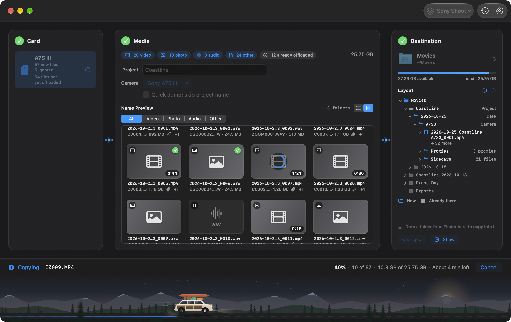

In the grid, each tile shows a thumbnail, the new name, the length, the type, and a paperclip count for sidecars that travel with it. The file being copied shows a progress ring. A verified file gets a green tick. Files offloaded earlier are dimmed. A missing copy is marked. A skipped short clip is marked, with **Include Anyway** in its menu.

Select files and press Space, double-click, or choose **Quick Look**. The arrow keys move through the files in the order on screen, following the filter. With several files selected, Quick Look steps through that selection. A format Quick Look cannot open says so, including *No preview available for .braw*.

Thumbnails come from Quick Look. Lodge makes them in the background, caches them by path, size, and modification date, and only reads them from the card. Formats Quick Look cannot draw, such as BRAW, R3D, MXF, and XML, show a symbol.

### Nothing new to copy

When the new files are already offloaded, Media says **All Caught Up**. If copies are missing, it offers **Re-offload Missing Copies**. If the only files left are short clips you skipped, the Offload button tells you to choose **Include Anyway** or **Include All Short Clips**. The button in that list is **Include All**.

## Copying

**Offload N Files** starts the copy. With one file it reads **Offload 1 File**. With nothing ready it reads **Offload Files** and the caption says why. See [Why Offload is waiting](#why-offload-is-waiting).

When everything is ready, the offload bar says **Ready. Every file is verified with SHA-256 after copying.** beside the button.

Each file is written as `<name>.lodge-partial`. Lodge reads that file back and hashes it. When the SHA-256 matches the card, the partial file is renamed to the final name. A mismatch deletes the partial file and the file is reported as a failure. The card is only read.

While it runs you see the current file, how far through the batch you are, the bytes copied, the time left, a **Verifying** state, and **Cancel**. The list follows the file being copied.


Time left appears after a couple of seconds of copying: **Estimating time…**, **Less than a minute left**, **About 3 min left**, and so on.

When it finishes, the summary reads like **57 copied · 0 skipped · 0 failed**. The copied count counts up. On a clean finish the checkmark draws itself, and Lodge plays the Glass sound if **Play a sound when an offload finishes** is on (it is, by default). Then: **Show in Finder**, **Eject Card**, **Done**, and **Format Card…** when the card is ready.


**Eject card after offload** is off by default. It ejects only when every file copied and verified. The same switch ejects the card after a successful format.

**Done** returns to the card. Files just copied show as already offloaded.

### Why Offload is waiting

The button’s caption is the reason:

| Caption | What to do |
| --- | --- |
| Insert a card to begin | Mount a card |
| Scanning card… | Wait for the scan |
| This card is empty | There is no media to copy |
| Enter a project name | The template uses `{project}` |
| Choose a camera | The template uses `{camera}` |
| Fix the naming template in Settings | An error in Settings > Naming |
| Choose a destination folder | Pick a folder |
| The destination folder isn’t connected — choose another | The drive is unplugged |
| Not enough space: needs …, … free | Free space, or pick another folder |
| Everything on this card is already offloaded | Nothing new to copy |
| N copies are missing at the destination — choose Re-offload | See [Re-offloading](#re-offloading) |
| Only short clips are left — choose Include All Short Clips to offload them | See [Short clips](#short-clips) |

## The ledger

Every verified copy is recorded in `~/Library/Application Support/Lodge/ledger.json`. Lodge recognizes a file by the card’s volume UUID, or its name when there is no UUID, plus the path on the card, the size, and the modification time. Change any of those and it counts as a different file.

Insert the same card again and Lodge copies only what the ledger does not already have.

If a recorded copy is missing, or the file at that path has a different size, Media warns you in orange. Those files are not copied again until you ask. Lodge does not re-hash the destination on every insert. It compares the size.

**Recent Offloads**, the clock in the toolbar, lists recent copies and can **Show in Finder**.

## Re-offloading

**Re-offload…** in Media:

- **Re-offload Missing Copies** copies files the ledger has whose copy is gone or changed size.
- **Re-offload Everything on This Card…** asks first, then copies the whole card again as new files.
- Per file, from the right-click menu: **Re-offload This File** or **Don’t Re-offload This File**. Sidecars and proxies of that clip come along.

Re-offloaded files are marked and always land as new copies. The usual naming rules apply, so they take the next sequence number, or `_2` at the end of the name. Existing files stay where they are.

**Forget This Card’s History…** clears the ledger entries for that card. Cancel is the default. The copies already at the destination are left alone. Until the card is offloaded again, it is not ready to format.

## Naming

Settings > Naming has a folder template and a file template. The default is:

```
{date}/{project}
{date}_{project}_{seq}
```

Which, for a project you type as “Beach Shoot” and a clip shot on 25 October 2026, lands as:

```
Destination/2026-10-25/BeachShoot/2026-10-25_BeachShoot_0001.mp4
```

The date is the file’s creation date, or its modification date when there is no creation date. The extension is always added, in lower case. Sequence numbers continue after the highest one already in that folder, so a second card from the same shoot picks up where the first stopped. Nothing is overwritten. A name that would collide, when the template has neither `{seq}` nor `{original}`, gets `_2`, `_3`, and so on.

`/` in the folder template makes a subfolder. An empty folder template puts files straight into the destination.

Click a token to insert it into the field you were editing. Mistakes are explained under the field: an unclosed `{`, an unknown token, `{seq}` used twice, `{seq}` in a folder, a name that starts with `.`, and characters file systems will not take (`: \ * ? " < > |`). Offload stays off until the errors are fixed. A warning, rather than an error, tells you when names may need `_2`.

**Reset to Default** in the **Examples** menu restores `{date}/{project}` and `{date}_{project}_{seq}`.

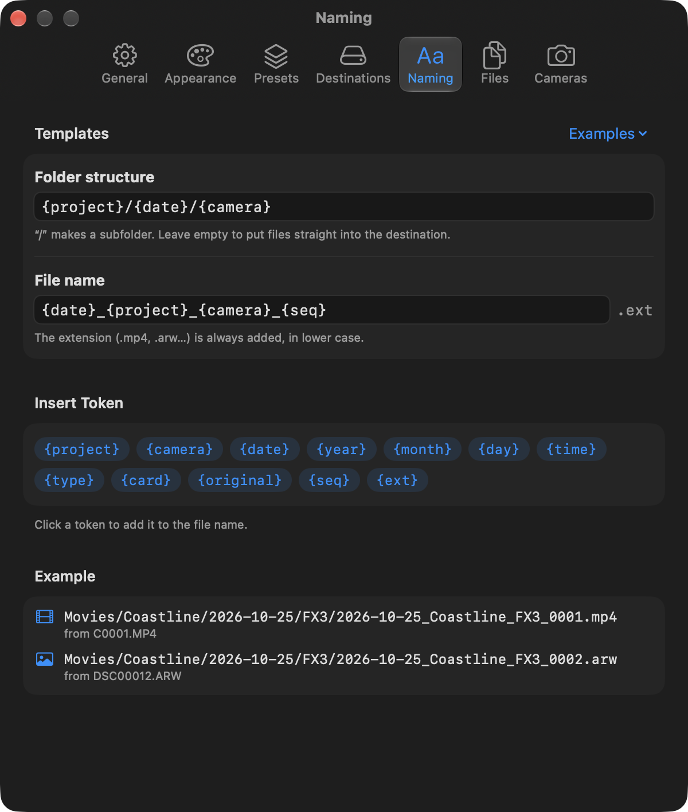

### Tokens

| Token | Becomes |
| --- | --- |
| `{project}` | Project name from the main window |
| `{camera}` | The camera’s short code, or its name when it has no code |
| `{date}` | Capture date, `2026-10-25` |
| `{year}` `{month}` `{day}` | `2026`, `10`, `25` |
| `{time}` | Capture time, `143005` |
| `{type}` | `Video`, `Photo`, `Audio`, or `Other` |
| `{card}` | The card’s volume name |
| `{original}` | The original file name without its extension |
| `{seq}` | Sequence number, `0001`. `{seq:3}` gives `001` |
| `{ext}` | The extension, such as `mp4` (the real extension is still added at the end) |

`{shoot}` still works as another name for `{project}`. A saved template that says `{shoot}` is updated, and a doubled `{project}` collapses to one.

### Examples

The **Examples** menu in Settings > Naming fills in a folder template and a file template. A preset, described under [Presets](#presets), saves a whole setup.

| Example | Folder | File |
| --- | --- | --- |
| Date / Project | `{date}/{project}` | `{date}_{project}_{seq}` |
| Project / Date / Camera | `{project}/{date}/{camera}` | `{date}_{project}_{camera}_{seq}` |
| Project / Type / Date | `{project}/{type}/{date}` | `{date}_{project}_{seq}` |
| Year / Month / Day | `{year}/{month}/{day}` | `{date}_{project}_{seq}` |
| Date / Project, Original Names | `{date}/{project}` | `{original}` |
| Flat | *(straight into the destination)* | `{date}_{project}_{seq}` |

The **Example** section under the fields shows a sample video and photo with the templates you have now.

The same folder structure is the **Layout** tree in Destination once a card is scanned. See [Drag and drop](#drag-and-drop).

## Quick dump

**Quick dump: skip project name** is for getting the footage off the card without typing a project. Lodge takes `{project}` out of both templates. `{date}/{project}` and `{date}_{project}_{seq}` become `{date}` and `{date}_{seq}`. Empty folder levels disappear. Numbering still continues from what is already in the folder.

In the Layout tree, a level that quick dump removes is struck through and tagged **Quick dump**.

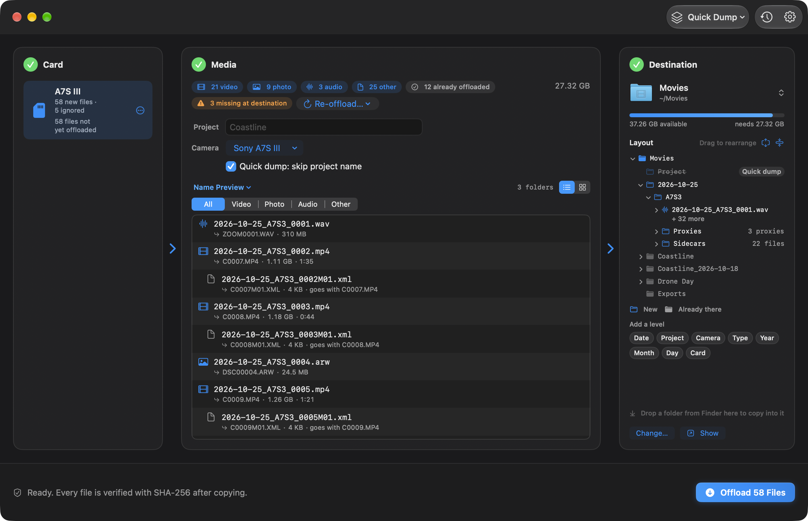

## Short clips

Accidental takes can stay on the card. **Settings > General > Skip videos shorter than** is a slider from **Off** to **30 s**, in steps of one second. The default is **5 s**, with skipping turned on. The value reads **Off** or **5 s**. The stepper beside the slider goes from Off up to 60 seconds.

Skipped videos stay on the card together with their sidecars and proxies. Media shows **2 short clips skipped**. Open that list and choose **Include Anyway** for one, or **Include All** for every one.

Clips whose length cannot be read, including BRAW and R3D, are always offloaded. A proxy such as `.lrv` is not skipped on its own. It follows its clip.

A card whose only remaining files are skipped short clips can still be formatted. The button then reads **Format and Discard 1 Short Clip** or **Format and Discard N Short Clips**.

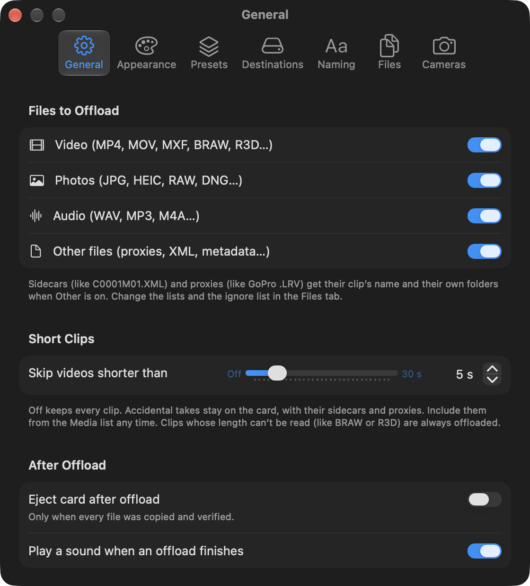

## Presets

A preset saves the destination, the folder and file templates, the camera, the short-clip setting, quick dump, and the file rules. You choose it from the menu. When a card is inserted, Lodge selects the camera you last used with that card, identified by the card’s volume UUID, or by its name when it has no UUID. The offload starts when you click **Offload**.

**Save Current Setup as Preset…** saves what the window is using now. Change any of that afterwards and the menu shows **Edited**, and offers **Update “Name”** for the preset in use. **Manage Presets…** opens Settings > Presets. With no preset selected the menu says **No Preset**.

In Settings > Presets you can add, rename, duplicate, edit, and remove presets. The one in use is marked **In use**, or **In use · edited** when the window has drifted from it. Editing the preset that is in use, while it still matches, updates the window too.

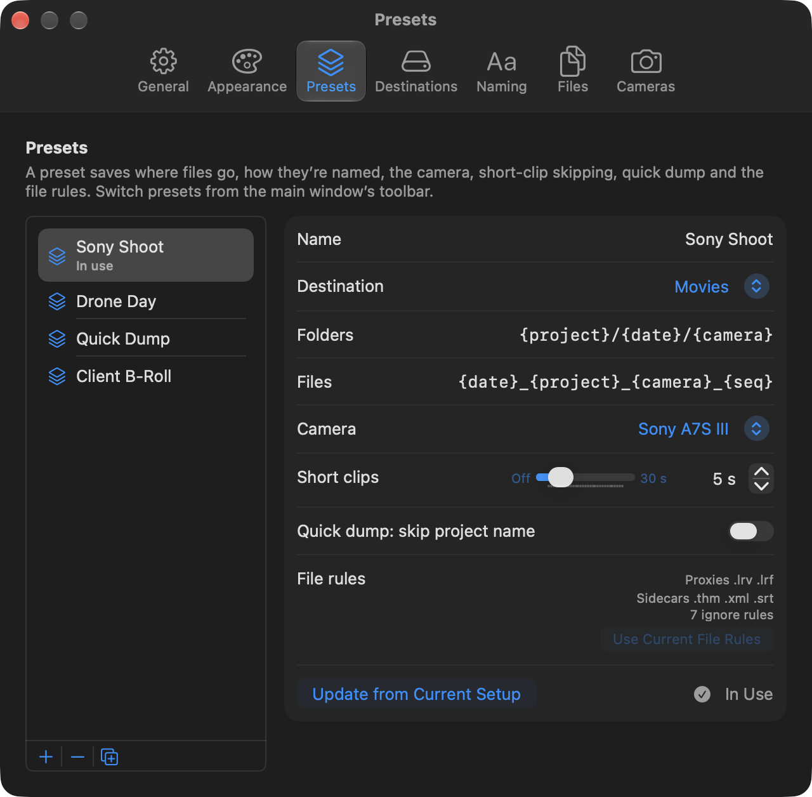

Presets are stored in `~/Library/Application Support/Lodge/presets.json`.

## Favorite destinations

Click the folder in Destination to see your favorites and their free space, plus **Choose Other Folder…** and **Edit Favorites…**. **Add “Folder” to Favorites** appears when the current folder is not in the list yet.

A favorite on a drive that is unplugged says **Not connected** and cannot be selected. The Offload button then says the destination is not connected.

**Settings > Destinations** adds, removes, renames (click the name), reorders by dragging, **Change Folder…**, and **Make Default**.

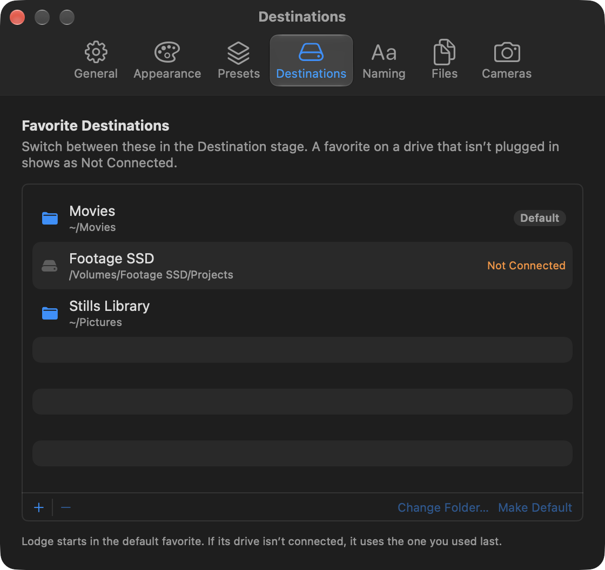

The list is `~/Library/Application Support/Lodge/destinations.json`. Each favorite keeps a bookmark, so Lodge can still open the folder after you rename or move it.

The next time Lodge opens, it selects the default favorite when that drive is connected. When it is not, Lodge selects the favorite you used last if that drive is connected, and otherwise any other connected favorite.

**Show** in Destination reveals the folder in Finder. **Change…** picks a folder that is not necessarily a favorite yet.

## Drag and drop

Drop a folder from Finder anywhere on Destination. The column lifts slightly and reads **Copy Files Here**. Dropping on the Layout tree does the same. A folder Lodge accepts gives a light click on a Force Touch trackpad. A file that is not a folder is refused.

Once a card is scanned, **Layout** shows every folder the offload will make, including **Proxies** and **Sidecars** when the plan has those files.

In Lodge 1.0.0 the header says **Drag to rearrange** while nothing is copying. Drag a level between folders, or drag a token from **Add a level** onto the tree. Click a token to add it at the end. Hover a level and click the remove button. Its help reads **Remove this folder level**. The tree shows one example file name. When the shoot has more than one folder, the extra ones are a line such as **+ 2 more folders**. A level that quick dump removes is struck through and tagged **Quick dump**.

## File rules

Settings > Files decides which extensions are proxies, which are sidecars, and which names are ignored.

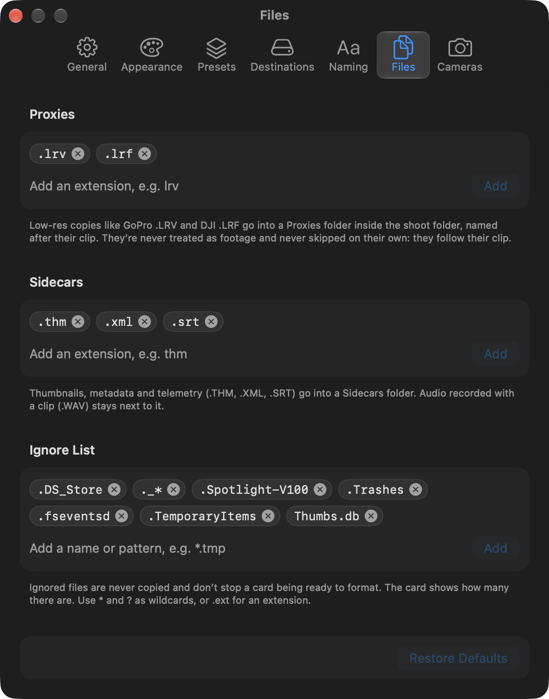

**Proxies** (default `lrv` and `lrf`) are low-resolution copies, such as a GoPro `.LRV` or a DJI `.LRF`. They go in a `Proxies` folder inside the shoot folder and take their clip’s new name. They are never treated as the footage, and they are not skipped as short clips on their own. They follow the clip.

**Sidecars** (default `thm`, `xml`, and `srt`) are thumbnails, metadata, and telemetry. They go in a `Sidecars` folder and keep the clip’s new name. Sony’s `C0001M01.XML` keeps the `M01`. A GoPro proxy named `GL010001.LRV` follows the clip `GX010001.MP4`. In Lodge 1.0.0, an audio file recorded next to a clip, such as `C0001.WAV`, stays beside the clip rather than in Sidecars, and shares its new name. Sidecars do not use up a sequence number.

A proxy or sidecar whose clip is not on the card keeps its own name.

**Ignore List** names are never copied. The defaults are `.DS_Store`, `._*`, `.Spotlight-V100`, `.Trashes`, `.fseventsd`, `.TemporaryItems`, and `Thumbs.db`. You can add a name, an extension (`.tmp` matches that extension), or a pattern with `*` and `?`. Lodge also always skips system junk, whether or not it is on the list: any name that starts with `.`, plus `System Volume Information`, `$RECYCLE.BIN`, `recycler`, `recycled`, `Thumbs.db`, and `desktop.ini`. An ignored folder is skipped with everything inside it.

The card line counts these. They do not block **Ready to format**. Formatting still erases them, and the confirmation says so. A pattern that would hide photos or video is marked, because those files would not be offloaded and a format would erase them.

**Restore Defaults** puts the three lists back.

Empty files are copied when they are not hidden and not ignored.

## Menu bar mode

Turn on **Settings > General > Menu Bar > Keep Lodge running in the menu bar** (off by default) and closing the window leaves Lodge running: it leaves the Dock and Command-Tab, keeps a cabin icon in the menu bar, and keeps watching for cards. Open Lodge from the icon, Finder, the Dock or Spotlight to bring the window back.

The icon’s menu has **Open Lodge**, **Import from “Card”…** for each connected card, **Pause Detection** (until Lodge quits), **Settings…** and **Quit Lodge**.

- **Show menu bar icon** (on). Turn it off, or Command-drag the icon out of the menu bar, to run without it. Lodge still asks to import. Turning menu bar mode off and on again does not hide the icon.
- **Open at login** starts Lodge in the menu bar, without a window. macOS may ask you to allow it in **System Settings > General > Login Items**. Turning menu bar mode off turns this off too.

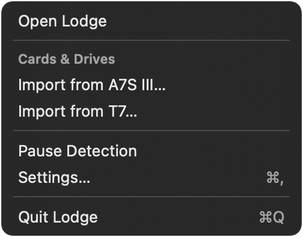

### Ask to import

**Ask to import when a card or drive is plugged in** is on by default and works whenever Lodge is running. When a card, or an external drive with camera folders or media, is plugged in while you are in another app, Lodge asks **“A7S III card connected. Import with Lodge?”** with **Import**, **Ignore** and **Don’t ask for this card**. **Import** opens Lodge with the card selected. Nothing is copied until you click Offload.

Lodge does not ask while you are looking at its window, while detection is paused, twice for the same card within 20 seconds, or for the startup disk, network volumes, disk images, Time Machine disks and your destination drives. A card plugged in during an offload or a format is asked about when it finishes. Cards you chose **Don’t ask** for are listed under the switch, each with **Ask Again**.

**Ask with** picks a notification or Lodge’s floating panel. The first time, macOS asks whether Lodge may send notifications. When notifications are off for Lodge, or its alert style is **None**, Lodge shows the floating panel instead. The panel sits in the top-right corner and never takes focus.

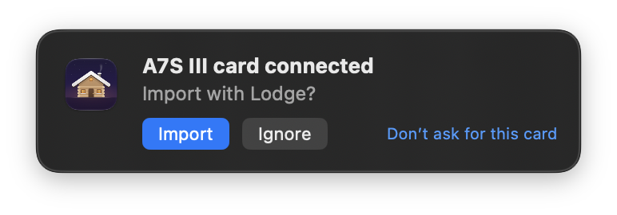

### If the prompt doesn’t show

macOS keeps notifications quiet while a Focus, such as Do Not Disturb, is on. If you plug in a card and see nothing, set **Ask with** to **Floating panel**. The panel shows during a Focus too.

## Support

Write to [bashframes@gmail.com](mailto:bashframes@gmail.com). If Lodge has been useful, [Support Lodge](https://bashframes.gumroad.com/l/lodge). Pay what you want.

## Ready to format

When every file on the card has a verified copy that is still at the destination, at the same size, the card shows a green **Ready to format** badge. The badge glows, and the seal bounces, when it appears. Otherwise the card says what is left: **3 files not yet offloaded**, **1 copy missing at the destination**, or **4 short clips not offloaded**.

**Format Card…** is in the card’s **…** menu, its right-click menu, and the bar after an offload. It is enabled only when the card is ready, or ready apart from short clips you chose to skip.

The confirmation is titled **Format “Card Name”?** Cancel is the default button, and it is the one Return presses. The other button reads **Format**, or **Format and Discard N Short Clips** when skipped clips would be lost. The message says what was copied and verified, calls out ignored items that were not copied, and says that formatting erases everything on the card. It also notes that formatting in the camera is usually best, because the camera sets the card up the way it expects.

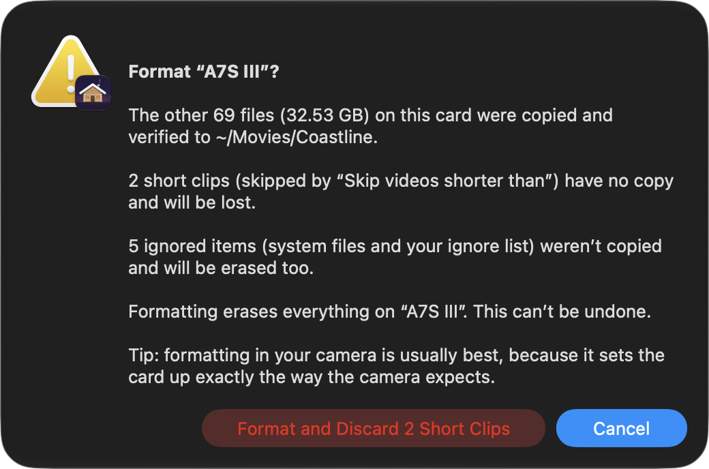

Lodge keeps the card’s file system when that system is exFAT, FAT32, or FAT16, and it keeps the card’s name (shortened to what that format allows). It uses `diskutil eraseVolume`. Anything else, such as APFS, is refused, with a note to format it in the camera.

Before it erases, Lodge checks again that this is still the card it scanned, and refuses unless the volume:

- is mounted under `/Volumes`, at the same place, and is a volume on a disk rather than the whole disk
- is removable media, such as an SD card in the built-in reader or a card reader, and is not the startup disk or another drive that is part of the Mac
- is not the drive your destination folder is on

If something on the card changed and is not offloaded, Lodge stops and tells you. With **Eject card after offload** on, the card is ejected after a successful format. Otherwise Lodge shows it again, empty, and says it was formatted and is ready for the camera.

## Themes and appearance

Lodge opens in **Dark** mode with the **Default** theme. Default is neutral black and white: no colour wash behind the window. In Dark mode the window is a neutral near-black. Buttons, switches, sliders, selected segments, selection, progress, and badges use the system accent. That accent is system blue unless you chose another in System Settings > Appearance. The ready-to-format badge and verified ticks stay green. Warnings stay orange. Destructive actions stay red.

**Aurora**, **Ocean**, **Twilight**, **Ember**, and **Forest** are optional colour themes. Each paints a soft wash behind the window, and uses its own gradient on the Offload button, the progress bar, the glowing border of the step that needs you, the dots that flow between the steps while a copy runs, and the glow when an offload finishes.

**Light**, **Dark**, and **System** are the appearance choices. Dark is the one Lodge starts with.

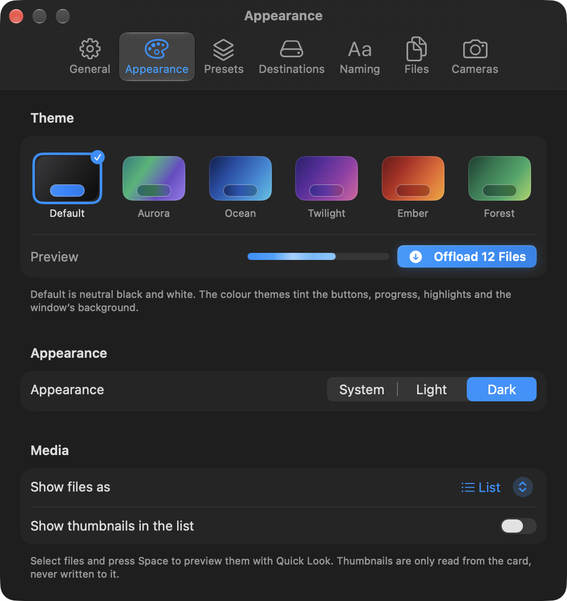

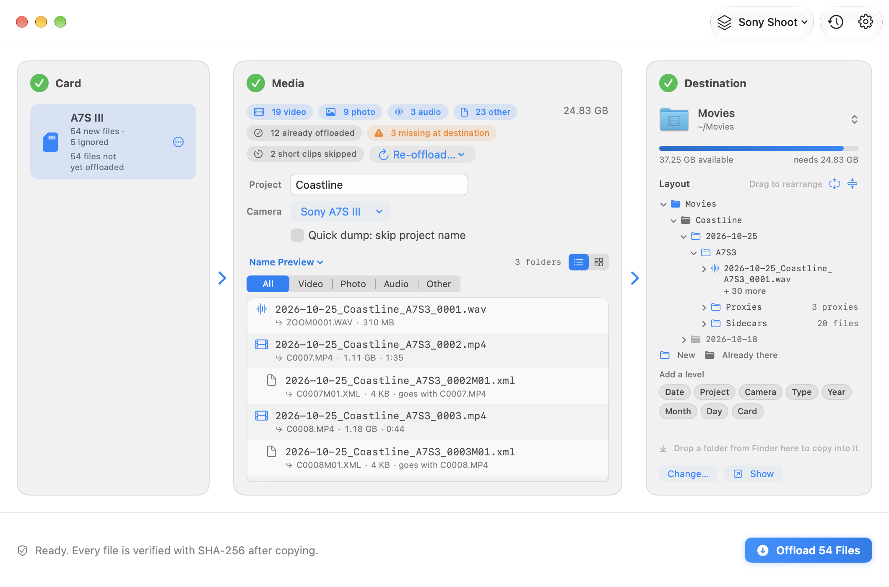

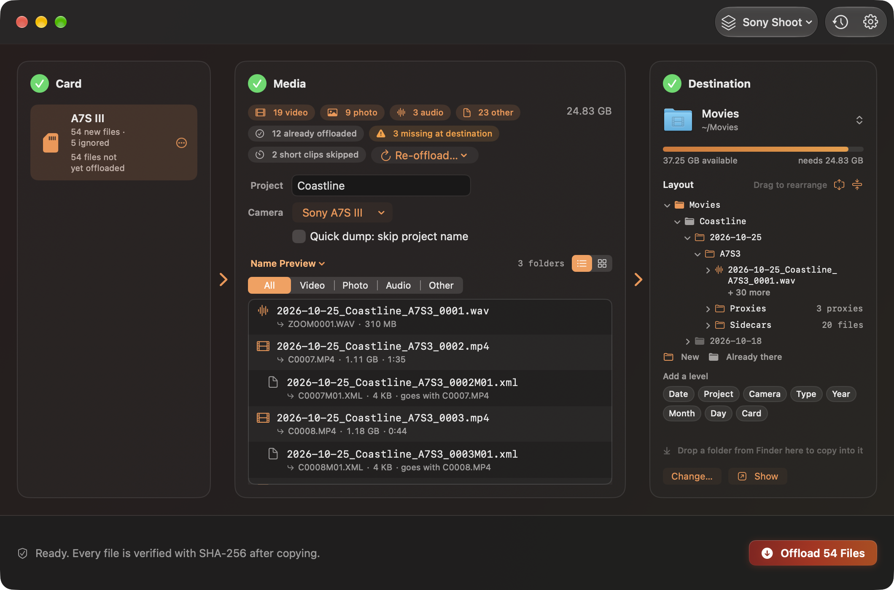

With **Increase Contrast** or **Reduce Transparency** on, every theme uses solid colours instead of gradients. The Appearance footer says so while either setting is on.

A saved theme named Comet or Graphite opens as Default.

**Show files as** switches Media between a list and a grid. **Show thumbnails in the list** applies to the list.

Animations follow **System Settings > Accessibility > Display > Reduce motion**. With it on, the checkmark appears whole, numbers do not count up, rows do not lift, and the card-insert glow is skipped.

### Motion

These run with Reduce Motion off:

- The finished checkmark draws itself in.
- The copied count, and the size of the new files, count up.
- Inserting a card plays a short accent glow around the card panel.
- Rows in the card list, and tiles in the grid, lift slightly under the pointer.
- The **Ready to format** badge glows when it appears.
- Dropping a folder onto Destination or the Layout tree, and dropping a level or a token onto the tree, gives a light click on a Force Touch trackpad when Lodge accepts the drop.

## Cameras

Settings > Cameras is a list of cameras. Each has a name, such as “Sony FX3”, and an optional short code, such as “A”, which is what `{camera}` writes. Add, rename, drag to reorder, and delete. Lodge remembers the camera you used with each card and selects it again next time. The list is `~/Library/Application Support/Lodge/cameras.json`.

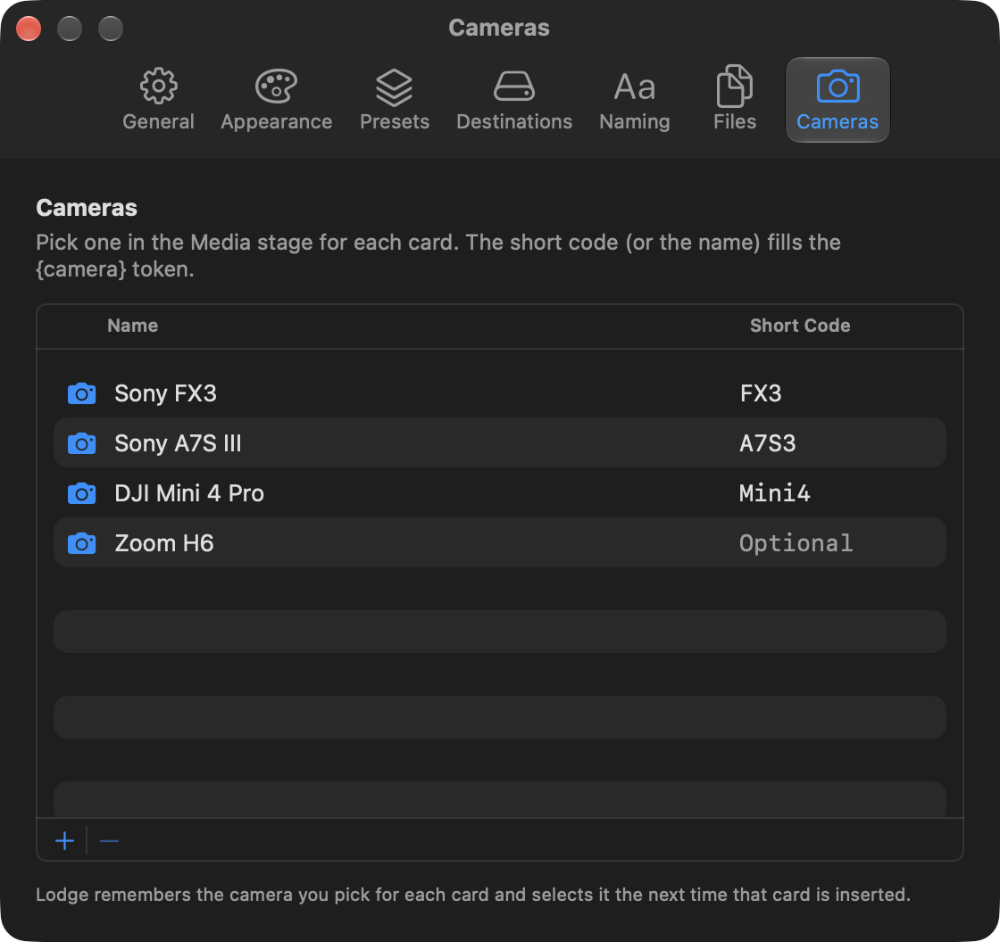

## File types

The type comes from the extension, in either case. Settings > General can turn each type off. All four are on by default. Sidecars and proxies are described there as travelling with their clip when **Other files** is on. The extensions themselves are edited in Settings > Files.

| Type | Extensions |
| --- | --- |
| Video | `mp4` `mov` `mxf` `braw` `r3d` `crm` `mts` `m2ts` `avi` `mkv` `insv` `360` |
| Photo | `jpg` `jpeg` `heic` `heif` `png` `tif` `tiff` `dng` `arw` `cr2` `cr3` `nef` `raf` `orf` `rw2` `srw` `pef` `gpr` `insp` |
| Audio | `wav` `mp3` `aac` `m4a` `bwf` |
| Other | Everything else, including `xml`, `lrf`, and `thm` |

`.lrv` is not in the video list. It is a proxy. With the default file rules it is copied into `Proxies/`.

## Where Lodge keeps your setup

| What | Where |
| --- | --- |
| Ledger | `~/Library/Application Support/Lodge/ledger.json` |
| Favorite destinations | `~/Library/Application Support/Lodge/destinations.json` |
| Cameras | `~/Library/Application Support/Lodge/cameras.json` |
| Presets | `~/Library/Application Support/Lodge/presets.json` |
| Templates, theme, appearance, file rules, short clips, and the other switches | Lodge’s preferences |

Lodge 1.0.0 does not connect to the network. Copying, the ledger, and settings stay on your Mac. Copying never uploads anything.

## With no card

Before a card is inserted the Card column is empty, Media explains that it is waiting, and Offload says **Insert a card to begin**.
