# User guide

Home base for your media. Your folders, your names, every card.

The window is three columns, left to right: **Card**, **Media**, and **Destination**. Plugging in a card does not start a copy. **Import** only opens Lodge with that card selected. Nothing is copied until you click **Offload N Files** (**Offload 1 File** for one file, or **Offload Files** when nothing is ready).

## Install and first launch

Open the .dmg, and drag Lodge to Applications.

Lodge requires macOS 14.0 or later. Lodge isn't notarized, so the first time, right-click Lodge and choose Open, or go to System Settings > Privacy & Security > Open Anyway.

### macOS 15 Sequoia and later

1. Open Lodge.
2. Click **Done** on the warning.
3. Go to **System Settings > Privacy & Security**.
4. Click **Open Anyway** next to Lodge, and confirm.

### macOS 14 Sonoma

1. Right-click or Control-click Lodge.
2. Choose **Open**.
3. Choose **Open** again.

During setup, Return is **Next: …** and **Save preset**. The done screen has **Open Settings**, **Open Lodge**, and **Skip setup**. You can open Settings any time with ⌘,.

During setup, each drive shows how much space is available.

## Trial and license

[3-day trial, then $10 once.](https://dl.bashfra.me/lodge/Lodge-1.0.dmg)

## Buying Lodge and entering your license key

1. Buy Lodge through the [Polar checkout](https://buy.polar.sh/polar_cl_gS9NEtdIPJuJDXu8sdui02XetKbkwKuHgiYxi4FBkM1), or click **Buy Lodge** inside the app.
2. Find your license key on the order confirmation page or email, or any time in the Polar customer portal.
3. In Lodge, click **Enter License Key**, paste the key, and confirm. After that, Lodge is yours to keep.

A license key works on 3 Macs.

## Your first offload

### When Lodge asks to import

Lodge asks **Import with Lodge?** when you plug in a camera card or a removable drive. It won't ask about your startup disk, a network or backup drive, a disk image, the drive you copy to, a favorite on that same drive, or a card you've told it to skip.

Lodge recognizes the folders most cameras use (for example `DCIM`, `PRIVATE/M4ROOT`, `XDROOT`, and `CLIPS001`).

Lodge waits 20 seconds before it asks about the same card again. If you plug a card in during an offload or a format, Lodge asks when that finishes.

The notification and the floating panel use the same title. A removable volume is a **card**. Anything else Lodge asks about is a **drive**. If the name is exactly card, drive, ssd, or disk, or it ends with a space plus one of those words, the title is **`<name>` connected** (for example **SD Card connected**). Otherwise it is **`<name>` card connected** or **`<name>` drive connected** (for example **A7S III card connected** or **T7 drive connected**).

The notification has three actions: **Import**, **Ignore**, and **Don’t Ask for This Card**.

Lodge shows the same prompt as a floating panel when permission is still undecided, alerts are off, the notification style is **None**, or **Ask with** is **Floating panel**. Its buttons are **Import**, **Ignore**, and **Don’t ask for this card**. The panel does not take the keyboard, so Return does not press **Import**.

If you don't see the prompt, set **Settings ▸ General ▸ Menu Bar ▸ Ask with** to **Floating panel**.

<figure>
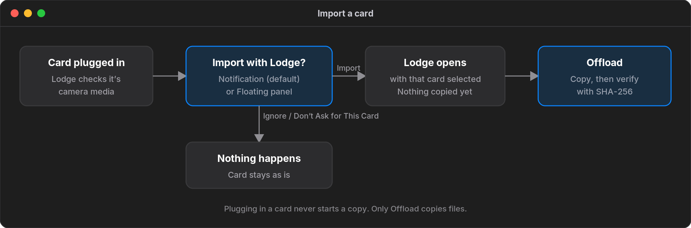
<figcaption>Import a card.</figcaption>
</figure>

<figure class="natural">
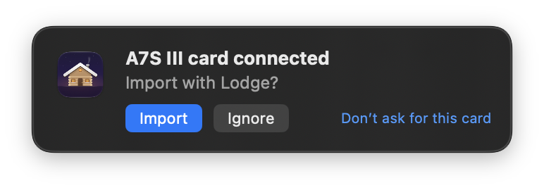
<figcaption>The import prompt: Import with Lodge?.</figcaption>
</figure>

**Import** opens Lodge with that card selected. Nothing is copied yet. Notifications are the default.

If card detection is paused, choose **Resume Detection** in the menu bar menu. That does not resume an offload.

### Offload

1. Insert a card.
2. Enter a project name if the template needs one.
3. Choose a destination.
4. Click **Offload N Files**.

While Lodge is ready, the bar says **Ready. Every file is verified with SHA-256 after copying.** The button help is **Copy and verify the new files**. You'll see **Copying**, then **Verifying**.

<figure>
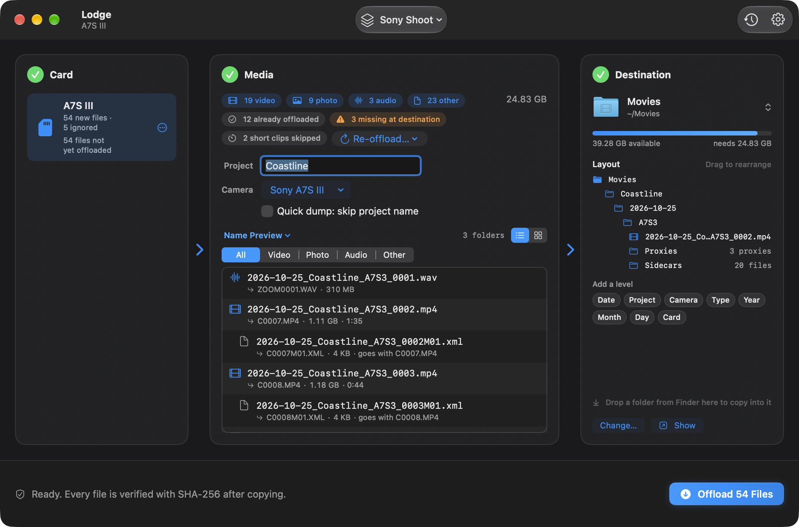
<figcaption>Lodge ready to offload.</figcaption>
</figure>

<figure>
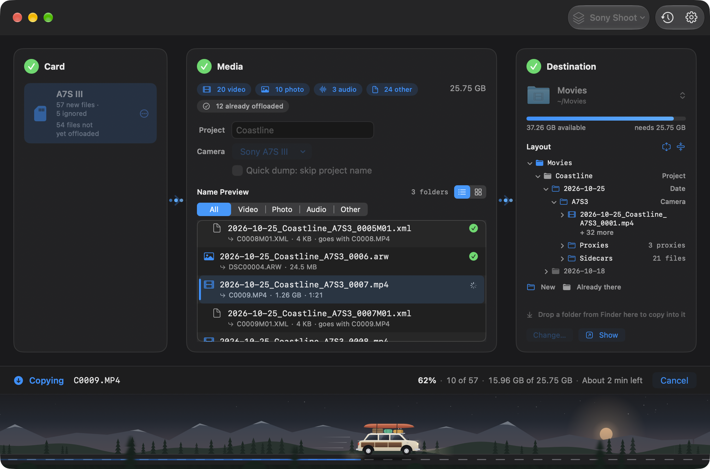
<figcaption>An offload in progress, in the Copying stage.</figcaption>
</figure>

You can also press Return to start.

If **Offload N Files** cannot start, its caption is one of the messages in [Why Offload is waiting](#why-offload-is-waiting).

## Verification

<figure>
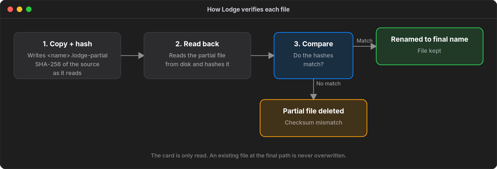
<figcaption>How Lodge verifies each file: copy and hash, read the partial file back, then rename it if the hashes match or delete it if they do not.</figcaption>
</figure>

Lodge copies one file like this:

1. It writes `<final name>.lodge-partial` and hashes the source with SHA-256 as it reads.
2. It reads that partial file back from disk and hashes it.
3. If the hashes match, it renames the partial file to the final name. If they do not, it deletes the partial file.

Lodge never changes anything on your card, and it never overwrites a file that's already at the destination.

Lodge remembers a verified copy by the card’s volume UUID, or the volume name when there is no UUID, plus the path on the card, the size, and the modification time in whole seconds. That match is not a content hash. Change the size or the modification time and Lodge treats the file as new. A copy counts as missing when that same record matches and the file at the destination is gone, or its size differs.

What you see when a file fails starts with the path on the card, then the reason. For example: `DCIM/100MEDIA/C0001.MP4: C0001.MP4 already exists — not overwriting it.` The reason is one of:

- **`<name>` already exists — not overwriting it.**
- **Couldn’t create `<name>` in the destination.**
- **Checksum mismatch for `<name>`. The copy was deleted.**

When the batch finishes, the title is **Offload Complete**, **Finished with Problems**, or **Offload Cancelled**.

The line under it is **`<copied>` copied · `<skipped>` skipped · `<failed>` failed**. If the card is already gone after an eject, that line gains — card ejected, safe to remove.

<figure>
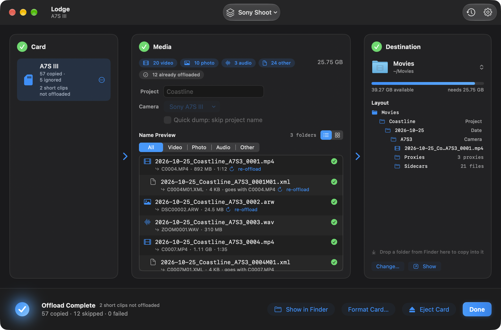
<figcaption>A finished offload.</figcaption>
</figure>

If a copy Lodge expected is missing at the destination, Offload tells you to choose Re-offload. The wording is in [Re-offload](#re-offload).

## Naming templates and tokens

The default folder template is `{date}/{project}`. The default file template is `{date}_{project}_{seq}`.

To start from a ready-made template, choose **Examples** in Settings ▸ Naming. The choices are **Date / Project**, **Project / Date / Camera**, **Project / Type / Date**, **Year / Month / Day**, **Date / Project, Original Names**, and **Flat**.

| Token | Meaning in the template editor | Rendered value |
| --- | --- | --- |
| `{project}` | Project name | the project field |
| `{camera}` | Selected camera | the camera’s code, when cleaning leaves one; otherwise the cleaned camera name |
| `{date}` | Capture date (2026-10-25) | `yyyy-MM-dd` |
| `{year}` | Year (2026) | `yyyy` |
| `{month}` | Month (10) | `MM` |
| `{day}` | Day (25) | `dd` |
| `{time}` | Capture time (143005) | `HHmmss` |
| `{type}` | Video, Photo, Audio or Other | **Video**, **Photo**, **Audio**, or **Other** |
| `{card}` | Card (volume) name | the volume name, cleaned like the project name. If that is empty, **Card** |
| `{original}` | Original file name, no extension | the source name, made safe |
| `{seq}` | Sequence number (0001); {seq:3} for 001 | at least 4 digits, unless `{seq:N}` says otherwise |
| `{ext}` | File extension (mp4) | the extension, lowercased |

In a file or folder name, `/`, `:`, `\`, `*`, `?`, `"`, `<`, `>`, `|`, and control characters become `-`. Spaces at the ends are trimmed, and leading dots are stripped so the name is not a hidden file.

The project name is cleaned separately. Letters, digits, and `-` stay. Any other character splits a word, and each word is capitalized, so "beach day" becomes `BeachDay`. The result is at most 60 characters, and leading or trailing `-` is removed.

Sequence numbers continue after the highest number already in the destination folder.

<figure>
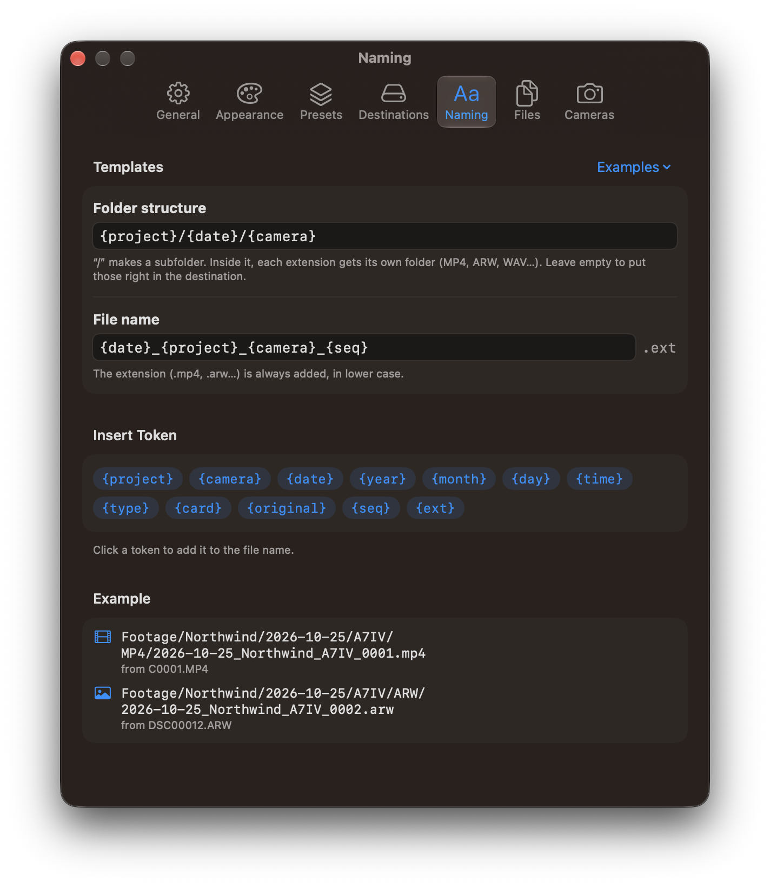
<figcaption>Settings, Naming.</figcaption>
</figure>

Inside the shoot folder, each extension gets its own folder. `.jpeg` and `.jpe` share **JPG**. `.tiff` shares **TIF**. `{ext}` stays that file’s own extension, lowercased.

## Presets and Quick dump

Saved presets start empty. The menu at the top right, just before Recent Offloads and Settings, lists them. It also has **Save Current Setup as Preset…**, **Update “name”** after you edit the setup in use, and **Manage Presets…**. **Manage Presets…** opens Settings ▸ Presets, where you rename, apply, duplicate, delete, reorder, and edit a preset. Presets are stored in `~/Library/Application Support/Lodge/presets.json`.

A preset saves where files go, how they're named, the camera, short-clip skipping, Quick dump, and the file rules. File type and date filters are set for each offload and are not saved in presets. With no preset chosen, the menu says **No Preset**. The photo-session setup uses the **Date / Project** naming example and suggests the preset name **Photo Session**.

On the setup done screen, Return can be **Offload with `<preset>`**.

**Quick dump** sits under Project in Media. It is off until you turn it on. The hint says **Skips the project name and dumps all the footage straight into a dated folder.** While it is on, the Project field is disabled and its prompt is **Not needed for a quick dump**. `{project}`, and the old `{shoot}` token, are taken out of the templates used for that offload only. The templates you saved stay as written. Empty folder levels disappear, so `{date}/{project}` becomes `{date}` and `{date}_{project}_{seq}` becomes `{date}_{seq}`. If the file template would have no token left, it becomes `{date}_{seq}`. The project you typed is not saved as the last project. Sequence numbers still continue. Each extension still gets its own folder. Proxies still go in `Proxies/` and sidecars in `Sidecars/`. A level Quick dump removes is struck through and tagged **Quick dump**.

<figure>
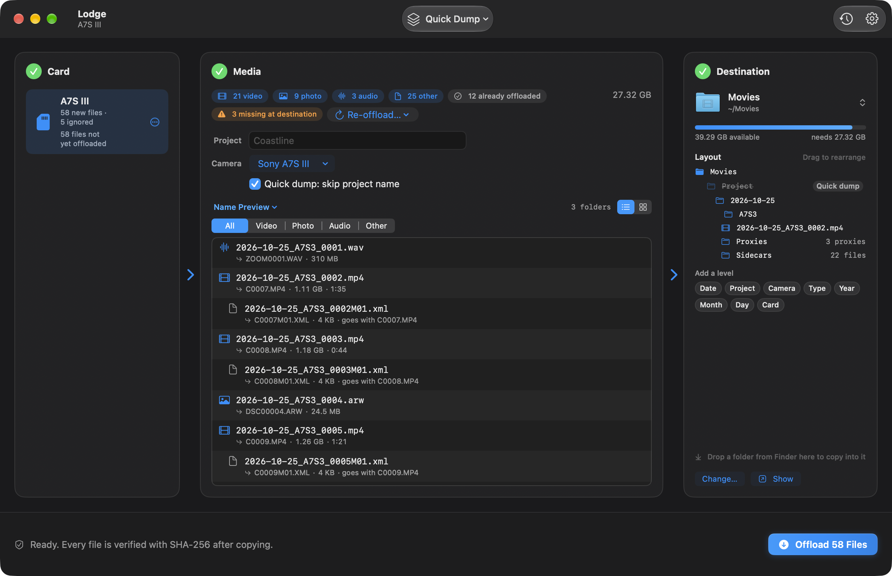
<figcaption>Quick dump available on the main window.</figcaption>
</figure>

## Sidecars and proxies

Proxies go in `Proxies/`. The default proxy extensions are `lrv` and `lrf`.

Sidecars go in `Sidecars/`. The default sidecar extensions are `thm`, `xml`, and `srt`.

They keep the clip’s new name.

<figure>
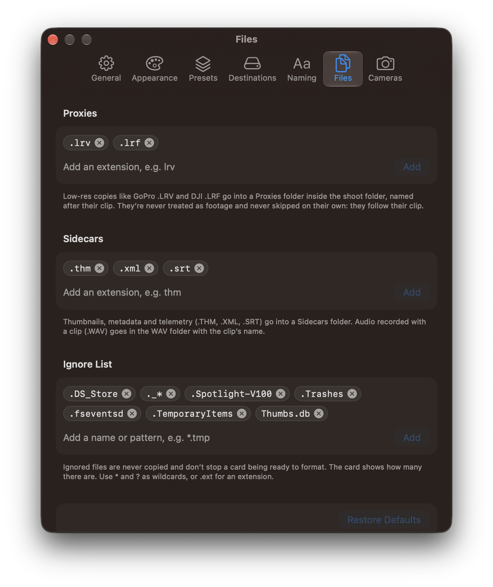
<figcaption>Settings, Files.</figcaption>
</figure>

By default, Lodge skips system files such as `.DS_Store`, `._*`, `.Spotlight-V100`, `.Trashes`, `.fseventsd`, `.TemporaryItems`, and `Thumbs.db`.

When a date filter is on, sidecars and proxies go with their clip. Everything else outside the chosen days stays on the card.

## Filtering by date and skipping short videos

**Dates** is **Any date** until you change it. The other choices are **Today**, **Last 7 days**, and **Custom range**.

The date-filter help says: **Copies only files from these days, by the date each file was created (or last changed, if the card doesn’t record that). Sidecars and proxies go with their clip. Everything else stays on the card.**

If the chosen days leave nothing new, Media shows **Nothing in These Dates**. Click **Show Any Date** to see everything. **Offload N Files** says **Nothing new in the chosen dates — choose Any date to see everything**.

**Short clips** skips videos shorter than the time you set. The slider runs from **Off** to **30 s**. The stepper beside it goes up to 60 seconds. The default is 5 seconds, with skipping on.

If the only videos left were skipped for length, Offload says one of:

- **Only a short clip is left — choose Include Anyway to offload it**
- **Only short clips are left — choose Include All Short Clips to offload them**

## Destinations and space

Until you pick a folder, the Destination stage shows **No Destination**. Click **Choose Folder…**, or drop a folder on it from Finder.

**Offload N Files** stays off, and says why, in these cases:

- **Choose a destination folder**
- **The destination folder isn’t connected — choose another**
- **Not enough space: needs `<needed>`, `<available>` free**

Each favorite shows how much space is available. A favorite that isn't plugged in says **Not connected**.

<figure>
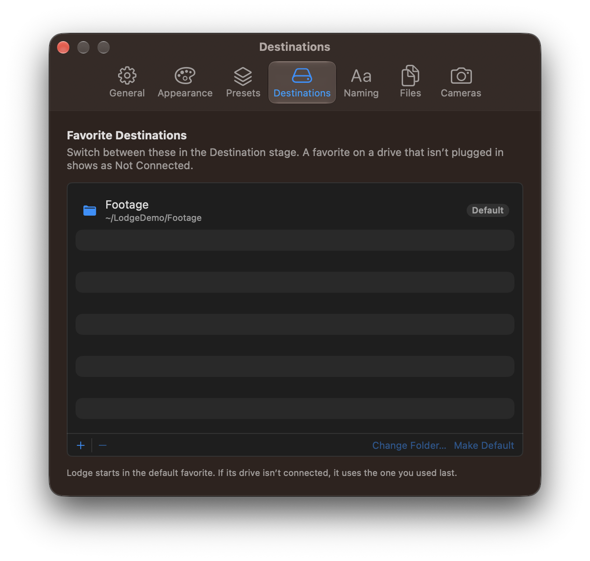
<figcaption>Settings, Destinations.</figcaption>
</figure>

Under the destination, Lodge shows **`<bytes>` available**, and **needs `<bytes>`** once there's something to copy.

A read-only destination uses one of:

- **This drive is read-only, so Lodge can’t write to it — choose another** when Lodge has no format name
- **This drive is read-only (NTFS). macOS can’t write to it.**
- **This drive is read-only (`<format>`), so Lodge can’t write to it — choose another** for any other format

Format names Lodge recognizes are **NTFS**, **exFAT**, **FAT32**, **Mac OS Extended**, and **APFS**.

## Re-offload

When copies are missing at the destination, **Offload N Files** says:

- **1 copy is missing at the destination — choose Re-offload**
- **`<n>` copies are missing at the destination — choose Re-offload**

In Media, **Re-offload…** is **Re-offloading N** while it is running. Its rows are **Re-offload Missing Copies** (with the count when there is one), **Re-offload Everything on This Card…**, and **Don’t Re-offload** while a re-offload is active. On a file, the menu is **Re-offload This File** or **Don’t Re-offload This File**.

**Re-offload Everything on This Card…** opens an alert whose buttons are **Re-offload Everything** (Return) and **Cancel**. That alert has no destructive button.

**Forget This Card’s History…** in **Card actions** opens an alert whose destructive button is **Forget History**. Return is **Cancel**.

## Eject or format the card

The manual command is **Eject Card**. After the card is gone, the label is **Ejected**.

**Eject Card** in the card menu is disabled during an offload, a format, or an eject. On the finish bar it is disabled only when the card is already gone, or while an eject is in progress. A format does not disable the finish-bar button.

**Eject card after offload** is off. Its caption is **Only when every file was copied and verified.** With it on, the card ejects only when the offload was not cancelled, nothing failed, at least one file was copied, and the card is still present. The same switch ejects the card after a successful format. After a successful eject, the finish line can end with — card ejected, safe to remove. If eject fails, that line ends with — Couldn’t eject `<card name>`: `<system message>`.

<figure>
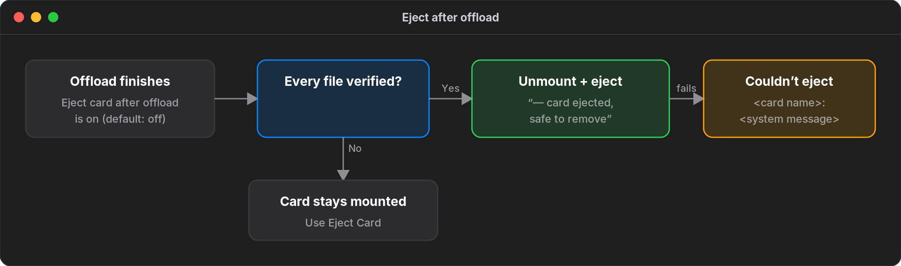
<figcaption>A simplified eject flow.</figcaption>
</figure>

The **Ready to format** badge shows when the card has at least one file, every file still has its copy at the destination at the same size, and no skipped short clip remains. Ignored system files do not block it. It appears on the selected card’s row and beside the finish-bar title. Its help is **Every file on this card has a verified copy at the destination.**

If the only leftovers are skipped short clips, the badge stays off. The line reads **1 short clip not offloaded** or **N short clips not offloaded**. **Format Card…**, in **Card actions** (the ⋯ button on the card) or on the finish bar, can still be used then. When the card is fully ready, its help is **Erase this card so it’s ready for new footage**.

Choosing **Format Card…** does not erase the card by itself. Lodge erases it only after you confirm. **Formatting erases everything on “`<card name>`”. This can’t be undone.** Before you format, check that the offload says **Offload Complete** and not **Finished with Problems**. While it runs you'll see **Formatting…**. When it's done you'll see **“`<name>`” was formatted and is ready for your camera.**

On the format confirmation, Return is **Cancel**. **Format**, **Format and Discard 1 Short Clip**, and **Format and Discard N Short Clips** have no key. The title is **Format “`<card name>`”?**

<figure>
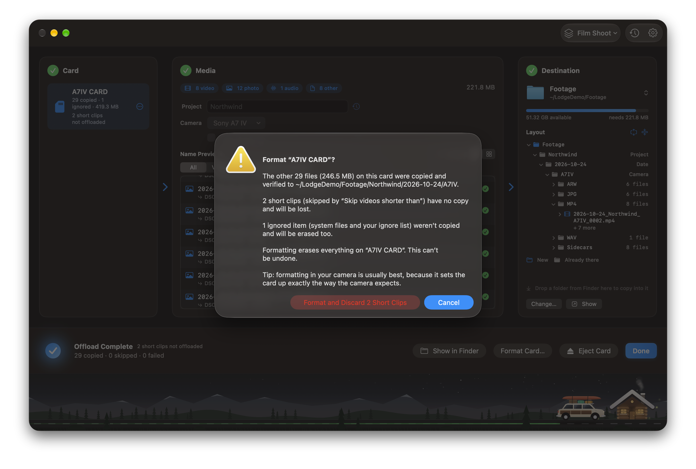
<figcaption>The format confirmation.</figcaption>
</figure>

## Menu bar mode

Turn on **Keep Lodge running in the menu bar** (off by default) so Lodge can watch for cards when its window is closed.

These sit with it:

| Setting | Default |
| --- | --- |
| Ask to import when a card or drive is plugged in | on |
| Show menu bar icon | on, and only shown while menu bar mode is on |
| Ask with | **Notification** (the other choice is **Floating panel**) |
| Open at login | off |

**Allow Lodge in System Settings ▸ General ▸ Login Items.** appears only while macOS is still waiting for you to approve **Open at login**.

The menu bar menu has:

- **Open Lodge**
- **Cards & Drives**, or **No Cards Connected** when nothing is mounted
- **Import from `<name>`…** for a connected card
- **Offloading… (imports wait until it’s done)** while a copy is running.
- **Pause Detection**, or **Resume Detection** while detection is paused
- **Settings…** (⌘,)
- **Quit Lodge** (⌘Q)

**⌘-drag** the menu bar icon out to turn **Show menu bar icon** off. If the icon is hidden, the hint says to quit with **⌘Q**.

<figure class="natural">
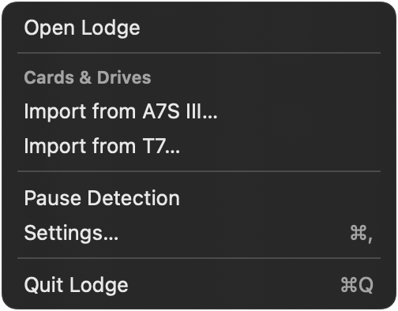
<figcaption>The menu bar menu: Open Lodge, cards and drives, Pause Detection, Settings, and Quit Lodge.</figcaption>
</figure>

## Settings reference

Settings tabs are **General**, **Appearance**, **Presets**, **Destinations**, **Naming**, **Files**, and **Cameras**.

In Settings ▸ Appearance, pick a theme: **Default**, **Aurora**, **Ocean**, **Twilight**, **Ember**, or **Forest**. Lodge starts in **Dark**, with the **Default** theme.

**Show files as** is **List**. The other choice is **Grid**. **Show thumbnails in the list** is off.

General groups these sections: **Files to Offload**, **Short Clips**, **After Offload**, **Menu Bar**, and **Updates**.

| Setting | Default |
| --- | --- |
| Destination folder | none, until you choose one |
| Eject card after offload | off |
| Folder template | `{date}/{project}` |
| File template | `{date}_{project}_{seq}` |
| Last project | empty |
| Recent projects | empty, and at most 6 |
| Files to offload | Video, Photos, Audio, and Other all on. The media filter says **Photo**. |
| Play a sound when an offload finishes | on |
| Short clips | On, 5 seconds. Slider from **Off** to **30 s**; the stepper goes to 60 seconds. |
| Theme | Default |
| Appearance | Dark |
| Show files as | List |
| Show thumbnails in the list | off |
| Quick dump | off |
| Dates | Any date |
| Keep Lodge running in the menu bar | off |
| Ask to import when a card or drive is plugged in | on |
| Show menu bar icon | on, while menu bar mode is on |
| Ask with | Notification |
| Open at login | off |
| Don’t ask for these cards | empty |
| Proxies | `lrv`, `lrf` |
| Sidecars | `thm`, `xml`, `srt` |
| Ignored names | `.DS_Store`, `._*`, `.Spotlight-V100`, `.Trashes`, `.fseventsd`, `.TemporaryItems`, `Thumbs.db` |
| Automatically check for updates | on |
| Update check interval | once a day |
| Automatically download and install updates | off |

<figure>
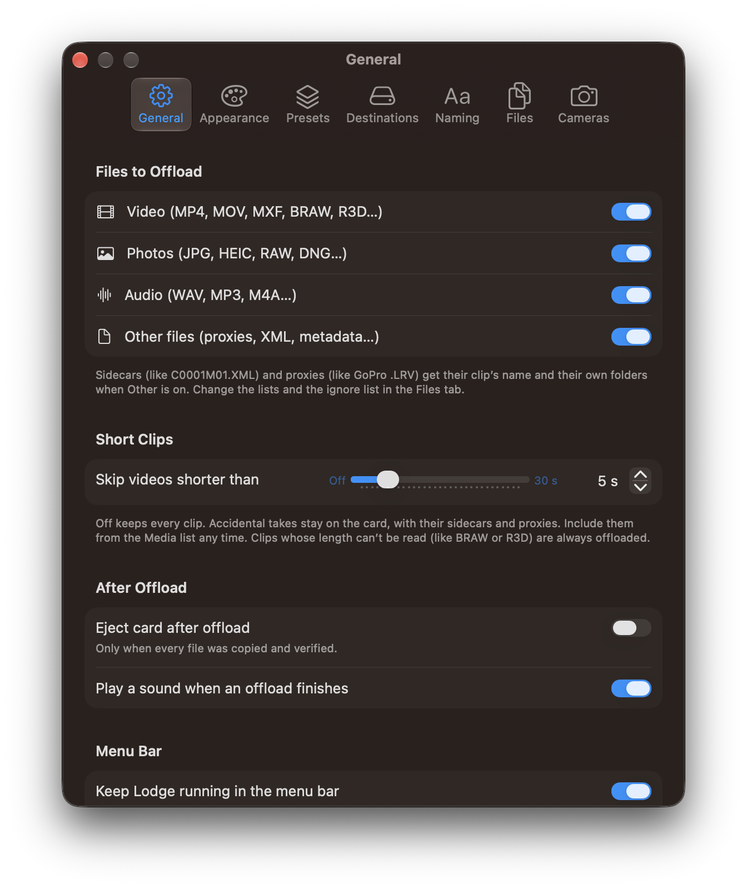
<figcaption>Settings, General.</figcaption>
</figure>

<figure>
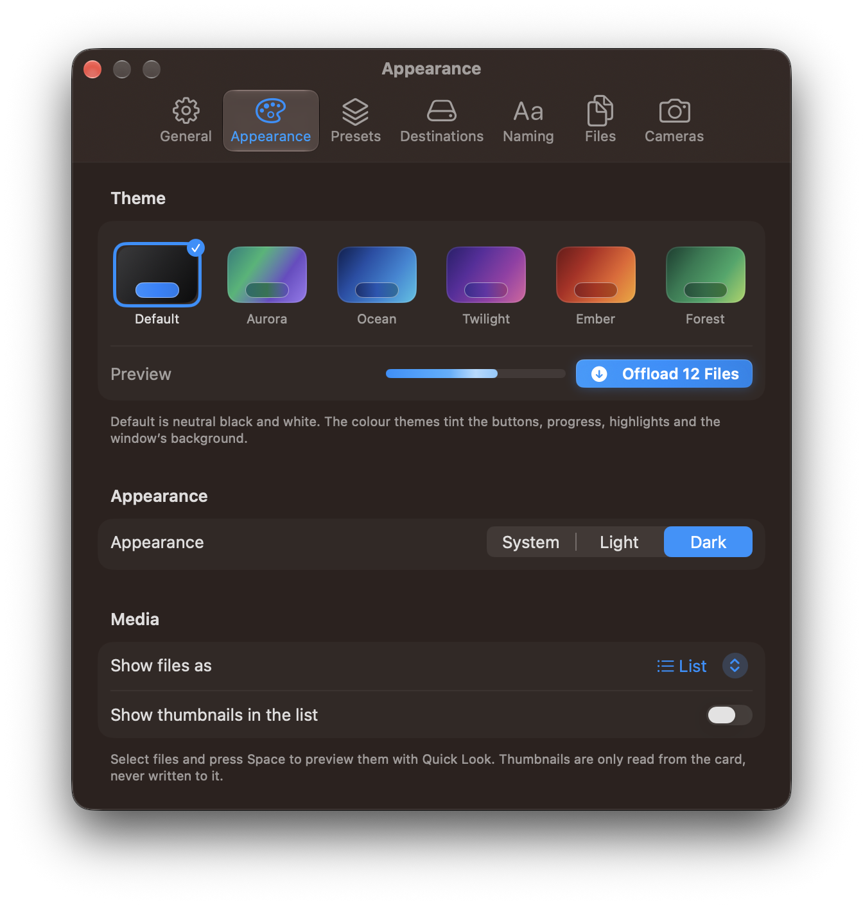
<figcaption>Settings, Appearance. Theme is Default.</figcaption>
</figure>

<figure>

<figcaption>Lodge in Dark mode with the Default theme, ready to offload.</figcaption>
</figure>

<figure>
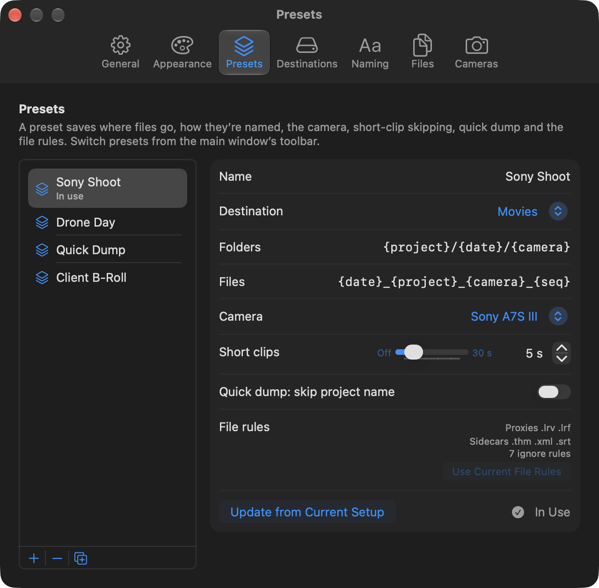
<figcaption>Settings, Presets.</figcaption>
</figure>

<figure>

<figcaption>Settings, Destinations.</figcaption>
</figure>

<figure>

<figcaption>Settings, Naming.</figcaption>
</figure>

<figure>

<figcaption>Settings, Files.</figcaption>
</figure>

<figure>
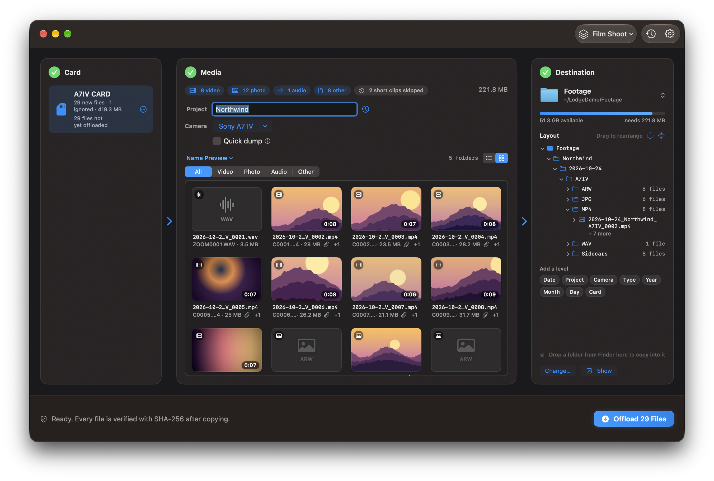
<figcaption>Media shown as a grid.</figcaption>
</figure>

<figure>
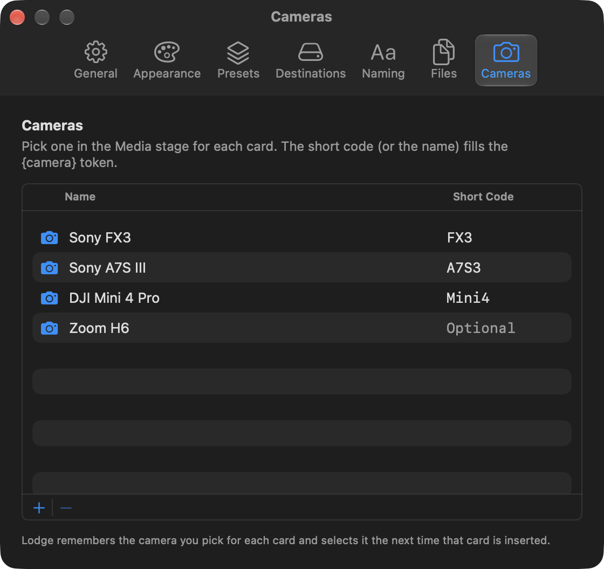
<figcaption>Settings, Cameras.</figcaption>
</figure>

The updates footer says: **Lodge checks for a new version once a day. You can also choose Lodge ▸ Check for Updates… any time.**

## Keyboard shortcuts

| Shortcut | What it does |
| --- | --- |
| ⌘, | Settings. The menu bar item uses the same key. The setup done screen shows **⌘ ,**. The Settings toolbar help is **Settings (⌘,)**. |
| ⌘Q | Quit. The hidden-icon hint says **quit it from there with ⌘Q.** |
| ⌘-drag | Drag the menu bar icon out to turn **Show menu bar icon** off. |
| Return | **Offload N Files**, Done, **Get started**, and **Offload with `<preset>`**. During setup, **Next: …** and **Save preset**. On the format confirmation and on **Forget History**, Return is **Cancel**. On **Re-offload Everything**, Return is that button. Return does not press **Import** on the floating panel. |
| Escape | **Cancel** during an offload. **Maybe Later** on the support note. Clears the selection in the list or grid. |
| Space | Quick Look on the selection. Space again closes Quick Look. The list and grid hint is **Press Space to preview the selected file with Quick Look**. |
| Up, Down, Left, Right | Move the selection in the list or grid. |
| ⌘-click | Toggle a file in the selection. |
| Shift-click | Extend the selection. |
| Double-click | Quick Look. |

The destructive buttons on the format confirmation and on **Forget History** have no keyboard equivalent. The other re-offload alert has **Re-offload Everything** (Return) and **Cancel**, and no destructive button.

<figure>

<figcaption>The media grid.</figcaption>
</figure>

## Troubleshooting

### Why Offload is waiting

<figure>
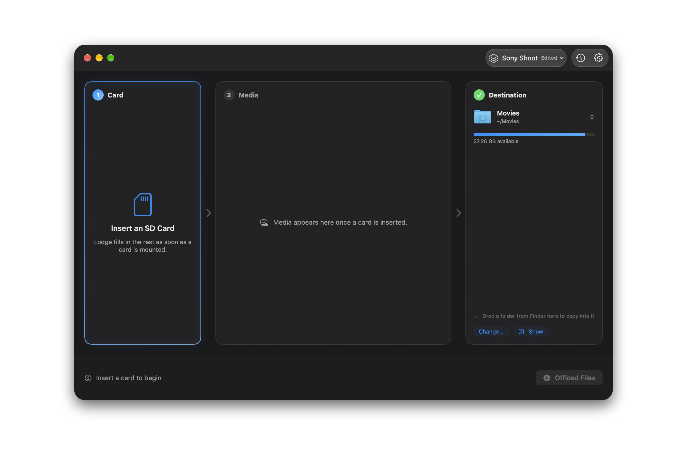
<figcaption>Lodge with no card.</figcaption>
</figure>

| Message | What it means |
| --- | --- |
| Insert a card to begin | No card yet. |
| Scanning card… | Lodge is still reading the card. The card column says **Scanning…**. |
| This card is empty | There is nothing to copy. |
| Enter a project name | The template uses `{project}`. |
| Choose a camera | The template uses `{camera}`. |
| Fix the naming template in Settings | The template is not usable. |
| Choose a destination folder | No folder yet. |
| The destination folder isn’t connected — choose another | That drive is not mounted. |
| Not enough space: needs `<needed>`, `<available>` free | The destination doesn't have room for this copy. Choose another folder, or make room. |
| 1 copy is missing at the destination — choose Re-offload | One expected copy is missing. See [Re-offload](#re-offload). |
| `<n>` copies are missing at the destination — choose Re-offload | Some files Lodge copied before are gone from the destination. Choose Re-offload to copy them again. |
| Only a short clip is left — choose Include Anyway to offload it | The only remaining video was skipped for length. |
| Only short clips are left — choose Include All Short Clips to offload them | The only remaining videos were skipped for length. |
| Nothing new in the chosen dates — choose Any date to see everything | The date filter is hiding every new file. |
| Everything on this card is already offloaded | There is nothing new to copy. |

A copy that does start can still fail. The list shows the path on the card, then one of:

- **`<name>` already exists — not overwriting it.**
- **Couldn’t create `<name>` in the destination.**
- **Checksum mismatch for `<name>`. The copy was deleted.**

### If the destination is read-only

- **This drive is read-only, so Lodge can’t write to it — choose another**
- **This drive is read-only (NTFS). macOS can’t write to it.**
- **This drive is read-only (`<format>`), so Lodge can’t write to it — choose another**

Recognized format names are **NTFS**, **exFAT**, **FAT32**, **Mac OS Extended**, and **APFS**.

### Report a bug

**Report a Bug…** is in the **Help** menu, alongside **Contact Support…** and **Support Lodge…**. It opens an email to bashframes@gmail.com. Nothing is sent until you send it.

The subject is **Lodge bug report (version `<version>`)**.

The body starts with **What happened?** and one of:

- **(What were you doing, and what went wrong? Steps to make it happen again help a lot.)**
- **(Lodge quit unexpectedly. What were you doing just before?)**

Then **Lodge `<version>`**, **macOS `<version>`**, and **Mac: `<model>`, `<chip>`**. Up to 200 of Lodge’s own log lines from the last three days go into the report. Paths under your home folder, `/Volumes`, `/Users`, `/private`, `/var`, and `/tmp` are replaced with `<path>`.

When Mail opens, the body lists **Attached: Lodge log.txt** and the log is that attachment. An empty log file contains **(nothing logged recently)**. A crash report goes out as a `.txt` file. With no Mail account, the message is a mailto: link: the log is in the body under **Lodge’s recent log:**, nothing is attached, and if a crash report was part of the send the body adds **(The crash report couldn’t be attached. It’s in Console ▸ Crash Reports, under Lodge.)**.

Lodge shows the prompt **“Lodge quit unexpectedly last time. Send a crash report?”** when a `Lodge-….ips` or `Lodge_….crash` report is newer than the last one it recorded. The first launch that sees this records the newest report and does not ask. It is also skipped in demo mode. The detail is **This opens a new email to bashframes with the crash report and Lodge’s recent log attached. File, card and drive names are left out. You can read it over before sending.** The buttons are **Send Report** and **Not Now**. Each report is offered once.

### If the card won't eject

The finish line ends with — Couldn’t eject `<card name>`: `<system message>`.

## Updates

**Automatically check for updates** is on. Lodge checks once a day. **Automatically download and install updates** is off.

The footer says: **Lodge checks for a new version once a day. You can also choose Lodge ▸ Check for Updates… any time.**

## Privacy

No account, no analytics, and copying never uploads anything. Lodge goes online for a daily update check, which you can turn off in Settings > General.

## Support

If Lodge saves you time, you can leave a tip on [Ko-fi](https://ko-fi.com/bashframes). Tips are optional and separate from the $10 license.

The support note is titled **Support Lodge**. Its body is **Lodge is made by one person at bashframes. If it saves you time, you can chip in with Tip Jar…. Thank you!** The buttons are **Don’t Ask Again**, **Maybe Later** (Escape), and **Tip Jar…**. **Tip Jar…** opens [ko-fi.com/bashframes](https://ko-fi.com/bashframes).

The note shows only when all of these are true:

- at least 5 offloads where every file was copied and verified
- at least 3 days after this version was first launched
- it has been shown fewer than 2 times
- you have not chosen **Tip Jar…** or **Don’t Ask Again**
- the next ask date is unset or has passed

**Maybe Later** waits 30 days. The note is not shown during a copy or a format.
